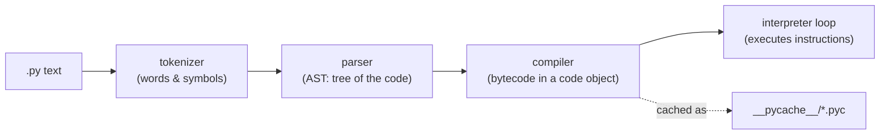

# How Python runs your code

> **Curriculum slug:** `how-python-runs-code` · **Written in:** M0 phase 1 · **Python version:** 3.15 (differences on 3.13/3.14 noted inline)
> **Prerequisites:** none. This is the first note.
> **Time to read:** ~25 minutes

## 1. The one-sentence version

When you run `python something`, CPython reads your source text, **compiles** it into a compact list of instructions called *bytecode*, and then a loop inside the interpreter **executes** those instructions one by one, and importing a module is nothing more than doing that once for another file.

## 2. Why you should care

Almost every surprise in Python has the same root cause: *code runs at a moment you didn't expect*.

- `import something` **runs** `something.py` from top to bottom. If that file opens a network connection at the top level, so does your import. C2 measures exactly this: slow imports are slow because importing runs code.
- `python file.py` and `python -m package` look similar but put different folders on Python's search path, which changes which files `import` finds.
- `cartographer --version` must answer in well under a second (spec 05 §6). The only way to keep it fast is to understand which modules run at startup and to avoid importing the heavy ones.

Cartographer itself is a tool that reads other people's code **without running it** (spec 00 §6). To appreciate why that's safe, you first need to see clearly what *running* means.

## 3. The idea, step by step

### Step 1: source code is only text

A `.py` file is a text file. Python can hold the same text in a string:

```pycon
>>> source = "x = 2 + 3\nprint(x * 10)"
>>> type(source).__name__
'str'
```

Nothing has happened yet. A string of code is as harmless as a string of poetry.

### Step 2: compiling turns text into a *code object*

`compile()` is the built-in function Python itself uses. It checks the syntax and produces a **code object**: the bytecode plus some bookkeeping (names used, constants, line numbers).

```pycon
>>> code = compile(source, "<demo>", "exec")
>>> type(code).__name__
'code'
>>> "x" in code.co_names
True
```

Still nothing has been printed. Compiling is like translating a recipe into another language: you haven't cooked anything.

If the text isn't valid Python, compiling fails *before anything runs*:

```pycon
>>> compile("def broken(:\n    pass", "<demo>", "exec")
Traceback (most recent call last):
  ...
SyntaxError: invalid syntax
```

### Step 3: executing runs the instructions

Only `exec` (or importing, or `python file.py`) actually runs the code:

```pycon
>>> exec(code)
50
```

You can peek at the bytecode with the standard `dis` ("disassemble") module. The exact instruction names change between Python versions, so here we only check that a familiar one is present:

```pycon
>>> import dis
>>> names = [instruction.opname for instruction in dis.get_instructions(code)]
>>> "STORE_NAME" in names
True
```

`STORE_NAME` is the instruction behind `x = ...`: "take the value on top of the stack and store it under the name `x`". The interpreter's main loop reads instructions like this one, one after another. That loop *is* "the Python interpreter".

### Step 4: a module is a file that has been run once

`import json` finds the file `json/__init__.py`, compiles it, **executes it**, and keeps the result (a *module object*) in a dictionary called `sys.modules`. The second `import json` finds the module already in `sys.modules` and doesn't run the file again.

Let's prove that with a tiny module written to a temporary folder:

```pycon
>>> import sys, tempfile
>>> from pathlib import Path
>>> folder = tempfile.mkdtemp()
>>> _ = Path(folder, "demo_once.py").write_text('print("running demo_once")\nVALUE = 42\n', encoding="utf-8")
>>> sys.path.insert(0, folder)
>>> import demo_once
running demo_once
>>> import demo_once
>>> demo_once.VALUE
42
>>> "demo_once" in sys.modules
True
```

The message appears **once**. The second import is a dictionary lookup. Let's tidy up so this example doesn't leak into anything else:

```pycon
>>> sys.path.remove(folder)
>>> del sys.modules["demo_once"]
```

### Step 5: `__name__` tells a module who it is

Every module has a `__name__`. Normally it's the module's import name:

```pycon
>>> import json
>>> json.__name__
'json'
```

But the file you *start* Python with is given the special name `"__main__"`. That's why this idiom works:

```python
def main() -> None:
    print("hello")

if __name__ == "__main__":   # true only when this file is the program being run
    main()
```

Run as `python greet.py` and it prints. Imported with `import greet` it doesn't, because `__name__` is `"greet"`.

### Step 6: `python -m package` runs `package/__main__.py`

`python -m json.tool` means "find the module `json.tool` the way `import` would, then run it as `__main__`". For a **package**, `-m` runs the package's `__main__.py`. That's how `python -m cartographer` works: our [`src/cartographer/__main__.py`](../../../src/cartographer/__main__.py) contains two lines:

```python
from cartographer.cli.main import main
raise SystemExit(main())
```

### Step 7: ending the program is an exception

`sys.exit(2)` raises `SystemExit(2)`. If nothing catches it, the interpreter stops and uses `2` as the process **exit code**, the number the shell (and CI) sees:

```pycon
>>> try:
...     raise SystemExit(2)
... except SystemExit as exc:
...     print("the exit code would be", exc.code)
the exit code would be 2
```

Because it's an ordinary exception, a test can catch it. Our CLI goes one step further: `main()` *returns* the code instead of exiting, so tests never have to catch anything (D-054).

## 4. How it really works (under the hood)



1. **Tokenizer.** Splits text into tokens: names, numbers, operators, strings, comments. (Note `tokenize-and-comments`, M0 phase 3.)
2. **Parser.** Builds an *abstract syntax tree* (AST), a tree of objects describing the structure. This is the stage Cartographer stops at: it parses and analyses the tree, and never goes on to compile and run it. (Note `ast-basics`, M0 phase 3.)
3. **Compiler.** Turns the AST into bytecode inside a code object.
4. **Interpreter loop.** Executes the bytecode. Since 3.11 the loop *specialises* hot instructions (for example, a `+` that always sees two integers gets a faster integer-only version), and an experimental JIT compiler exists in 3.13+.

**The bytecode cache.** Compiling takes time, so when Python imports a module it saves the code object to a `.pyc` file in a `__pycache__` folder next to the source. Next time, if the source hasn't changed, it loads the `.pyc` and skips steps 1–3. The file name includes an interpreter tag, so 3.13 and 3.15 never use each other's caches:

```pycon
>>> sys.implementation.cache_tag
'cpython-3...'
>>> import importlib.util
>>> Path(importlib.util.cache_from_source("mod.py")).name.endswith(".pyc")
True
>>> Path(importlib.util.cache_from_source("mod.py")).parent.name
'__pycache__'
```

The script you run directly (`python file.py`) is *not* cached. Only imported modules are.

**What goes on `sys.path`.** `sys.path` is the list of folders `import` searches, in order. Its first entry depends on how you started Python:

| You ran | `sys.path[0]` |
|---|---|
| `python path/to/file.py` | the folder containing `file.py` |
| `python -m pkg.mod` | the current working directory |
| `python -c "..."` or the REPL | the current working directory (shown as `''`) |
| `python -I ...` (isolated mode) | none of the above is added |

That first row is the reason for a safety rule in spec 00 §6: if you run a script that lives *inside* a folder of untrusted files, a planted `json.py` next to it would be imported instead of the real `json`. `-I` (isolated mode) prevents that.

## 5. Where Cartographer uses this

| File / function | How it's used |
|---|---|
| [`src/cartographer/__main__.py`](../../../src/cartographer/__main__.py) | Makes `python -m cartographer` work (step 6) and exits with `SystemExit` (step 7) |
| [`src/cartographer/cli/main.py`](../../../src/cartographer/cli/main.py): `main()` | Returns an exit code instead of calling `sys.exit`, and catches argparse's `SystemExit` |
| [`src/cartographer/cli/main.py`](../../../src/cartographer/cli/main.py): `version_string()` | Imports `core.versions` *inside* the function, so the module's top level stays light |
| [`src/cartographer/__init__.py`](../../../src/cartographer/__init__.py) | Kept tiny, because it runs on every import of anything in the package |
| [`src/conftest.py`](../../../src/conftest.py) | Stops pytest from importing `__main__.py`, because importing it would *run* the CLI |

## 6. Pitfalls

### Pitfall 1: "I only imported it, why did it do something?"
Importing runs the module's top level. Anything that isn't inside a function or class runs on import: prints, file reads, network calls. Keep module top levels to definitions and cheap constants.

### Pitfall 2: circular imports see half-finished modules
Python puts a module into `sys.modules` *before* it finishes running it. If `a` imports `b` and `b` imports `a`, then `b` gets a partially initialised `a`, and names defined further down `a` don't exist yet. That's C1's subject (note `circular-imports`).

### Pitfall 3: naming your file after a standard module
A file called `random.py` in your project folder hides the standard `random` module, because your folder comes first on `sys.path`. The error messages that follow are confusing ("module 'random' has no attribute 'randint'"). We avoid names like `ast.py`, `json.py`, `typing.py` and `code.py` for this reason (spec 02 §2).

### Pitfall 4: `sys.exit()` inside a library
A library function that calls `sys.exit` kills whoever called it, including a test runner or a web server. Libraries raise exceptions. Only the outermost entry point decides the exit code.

## 7. Version notes

- **3.11+:** the specialising interpreter (faster bytecode for common cases).
- **3.13:** an experimental JIT and the experimental free-threaded build (no GIL).
- **3.14:** the free-threaded build becomes officially supported (PEP 779).
- **3.15:** **explicit lazy imports** (PEP 810, `lazy import json`), so the module runs on first *use* instead of at the import line. That's C2's subject, and it changes step 4 above for modules imported lazily. Cartographer's own source must still be valid 3.13 syntax (D-005), so we use the compatibility form `__lazy_modules__`.

## 8. Exercises

1. Create `hello.py` containing `print(__name__)`. Run `python hello.py`, then run `python -c "import hello"` in the same folder. What's printed each time, and why?
   <details><summary>Answer</summary>

   `__main__` the first time, because the file you start Python with is always named `__main__`. `hello` the second time, because an imported module is named after its import name.
   </details>

2. After `import json`, look for a `__pycache__` folder inside the `json` package folder (`import json, os; os.path.dirname(json.__file__)`). What do the file names tell you?
   <details><summary>Answer</summary>

   Names like `decoder.cpython-315.pyc`: the module name, the interpreter tag (`cpython-315`), and `.pyc` for compiled bytecode. Different Python versions keep separate caches side by side.
   </details>

3. Run `uv run python -m cartographer --version` and then `uv run cartographer --version`. Which file in `src/cartographer/` runs first in each case?
   <details><summary>Answer</summary>

   In both cases `cartographer/__init__.py` runs first, because importing anything inside a package runs the package's `__init__`. With `-m`, Python then runs `cartographer/__main__.py` as `__main__`. With the console script, the generated launcher imports `cartographer.cli.main` and calls `main()` directly, so `__main__.py` never runs.
   </details>

4. Why does `compile("1 +", "<x>", "exec")` fail, while `compile("1 / 0", "<x>", "exec")` succeeds?
   <details><summary>Answer</summary>

   `1 +` isn't valid syntax, and compiling checks syntax. `1 / 0` is perfectly valid syntax; dividing by zero is a problem that can only happen when the code *runs*.
   </details>

## 9. Further reading

- Official docs: [The import system](https://docs.python.org/3/reference/import.html) · [`dis`](https://docs.python.org/3/library/dis.html) · [Command line and environment (`-m`, `-I`)](https://docs.python.org/3/using/cmdline.html) · [`__main__`](https://docs.python.org/3/library/__main__.html)
- PEP: [PEP 3147: `__pycache__` directories](https://peps.python.org/pep-3147/) · [PEP 810: explicit lazy imports](https://peps.python.org/pep-0810/)
- Optional extras: [Python behind the scenes (blog series)](https://tenthousandmeters.com/tag/python-behind-the-scenes/)
