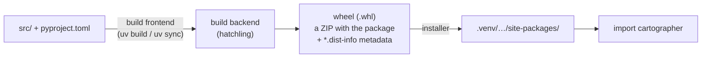

# Project layout and `pyproject.toml`

> **Curriculum slug:** `project-layout-and-pyproject` · **Written in:** M0 phase 1 · **Python version:** 3.15 (same on 3.13/3.14)
> **Prerequisites:** [How Python runs your code](how-python-runs-code.md)
> **Time to read:** ~30 minutes

## 1. The one-sentence version

A Python *project* is a folder with a `pyproject.toml` file that says what the project is called, which Python it needs, what it depends on and how to build it, plus the code itself, which we keep in `src/cartographer/` so tests always use the *installed* package rather than the loose files.

## 2. Why you should care

Every Python tool you'll use on this project (uv, pytest, ruff, mypy, hatchling) reads its settings from **one** file, `pyproject.toml`. If you can read that file, you can answer "how is this project built, tested and checked?" for almost any modern Python repository, not only this one.

The *layout* (where the code lives) matters too. One wrong choice gives you the most confusing class of bugs: tests that pass on your machine and then fail for every user, because the tests imported the files on disk while users get the files that were actually packaged.

## 3. The idea, step by step

### Step 1: module vs. package

- A **module** is one `.py` file. `json/decoder.py` is the module `json.decoder`.
- A **package** is a folder of modules that you can import with dotted names. A package has a `__path__` attribute (where its modules live). A plain module doesn't.

```pycon
>>> import json, json.decoder
>>> hasattr(json, "__path__")
True
>>> hasattr(json.decoder, "__path__")
False
```

A folder becomes a *regular package* by containing `__init__.py`. That file runs the first time anything in the package is imported (see [how Python runs code](how-python-runs-code.md), step 4). Folders *without* one can still be *namespace packages* (PEP 420). That's a C1 topic.

### Step 2: Cartographer's layout

```
Cartographer/                 ← the project (repository) root
├── pyproject.toml            ← what the project is and how to build/test it
├── src/
│   └── cartographer/         ← the import package: `import cartographer`
│       ├── __init__.py
│       ├── __about__.py      ← __version__ lives here (D-010)
│       ├── __main__.py       ← makes `python -m cartographer` work
│       ├── cli/ … core/ …
│       └── py.typed          ← "this package ships type hints" (PEP 561)
├── tests/                    ← tests import `cartographer` like any user would
├── scripts/                  ← developer tools (not part of the package)
└── docs/
```

Note the two different names: the **distribution** (what you install, PyPI's name) is `cartographer-py`. The **import package** (what you write after `import`) is `cartographer`. They often match, but they don't have to. We had to change ours because `cartographer` was already taken on PyPI (D-003).

### Step 3: why `src/`? The "tests import the wrong copy" problem

Imagine the package lived at the root (`Cartographer/cartographer/`, the "flat layout"). When you run `pytest` from the root, the root folder is on `sys.path`, so `import cartographer` finds the **folder on disk**, not the installed package.

Now suppose you forgot to include a data file in the wheel (the built package). Tests pass, because the file is on disk. Users install the wheel, and it crashes, because the file isn't in it.

With `src/`, the root no longer contains a `cartographer` folder, so the only way to import it is through the **installed** package. The development install (`uv sync`) is an *editable* install: the environment points back at `src/`, so your edits take effect immediately, but the import still goes through the packaging machinery. You can see where the package really comes from:

```pycon
>>> import cartographer
>>> from pathlib import Path
>>> Path(cartographer.__file__).name
'__init__.py'
>>> Path(cartographer.__file__).parent.parent.name
'src'
```

### Step 4: `pyproject.toml` is TOML

TOML is a configuration language: `key = value` pairs grouped under `[table]` headers. Python ships a reader, `tomllib` (3.11+):

```pycon
>>> import tomllib
>>> doc = tomllib.loads('[project]\nname = "demo"\ndependencies = ["requests>=2"]\n')
>>> doc["project"]["name"]
'demo'
>>> doc["project"]["dependencies"]
['requests>=2']
```

Let's read *our* file the same way:

```pycon
>>> root = Path(cartographer.__file__).resolve().parents[2]
>>> config = tomllib.loads((root / "pyproject.toml").read_text(encoding="utf-8"))
>>> config["project"]["name"]
'cartographer-py'
>>> config["project"]["requires-python"]
'>=3.13'
>>> config["build-system"]["build-backend"]
'hatchling.build'
```

### Step 5: our `pyproject.toml`, table by table

Open [`pyproject.toml`](../../../pyproject.toml) next to this list.

| Table | What it's for | Who reads it |
|---|---|---|
| `[build-system]` | Which **build backend** turns the source into a wheel (`hatchling`, D-033), and what to install to run it | `uv build`, `pip`, any installer |
| `[project]` | Standard metadata (PEP 621): name, description, `requires-python`, licence, classifiers, `dependencies` (none yet) | Installers and PyPI |
| `dynamic = ["version"]` | "the version isn't written here; ask the backend". Hatchling reads it from `__about__.py` (`[tool.hatch.version]`) | hatchling |
| `[project.scripts]` | **Console-script entry points**: `cartographer = "cartographer.cli.main:main"` means "create a `cartographer` command that imports `cartographer.cli.main` and calls `main()`" | Installers |
| `[project.urls]` | Links shown on PyPI | PyPI |
| `[dependency-groups]` | Development-only dependencies (PEP 735): pytest, ruff, mypy… They are **not** installed for users | uv |
| `[tool.hatch.*]` | Hatchling's own settings (where the version is, which folder is the package) | hatchling |
| `[tool.cartographer]` | Cartographer's settings for analysing *this* repo (dogfooding, D-048) | Cartographer |
| `[tool.ruff]`, `[tool.mypy]`, `[tool.pytest.ini_options]`, `[tool.coverage.*]` | Each tool's configuration | that tool |

`[tool.<name>]` is a convention: any tool can claim a table under `tool` for its settings, which is why one file can configure everything.

### Step 6: entry points, the bridge from a command to a function

After `uv sync`, the installer has read `[project.scripts]` and written two small launcher programs into the environment (`.venv/Scripts/cartographer.exe` and `carto.exe` on Windows, `.venv/bin/cartographer` on Linux). The installed package's metadata records the same information, and you can query it:

```pycon
>>> from importlib.metadata import entry_points
>>> sorted(ep.name for ep in entry_points(group="console_scripts") if ep.value.startswith("cartographer."))
['carto', 'cartographer']
>>> [ep.value for ep in entry_points(group="console_scripts", name="carto")]
['cartographer.cli.main:main']
```

Entry points aren't only for commands. A package can declare *any* named group, and other programs can discover those entries at runtime. That's how C3 will let other people's packages add rules to Cartographer (group `cartographer.rules`).

## 4. How it really works (under the hood)



- A **build frontend** (uv, pip) reads `[build-system]`, installs the backend in a temporary environment, and asks it to build.
- The **build backend** (hatchling) produces a **wheel**: a ZIP file containing the package files plus a `cartographer_py-0.0.1.dist-info/` folder holding `METADATA` (name, version, dependencies), `entry_points.txt` and `RECORD` (every file with its hash). C6 opens wheels to inspect exactly these files.
- An **editable** install (what `uv sync` does for the project itself) installs only the metadata plus a small `.pth` file that points Python at `src/`. That's how `Path(cartographer.__file__)` ends in `src/cartographer/__init__.py`.

## 5. Where Cartographer uses this

| File / function | How it's used |
|---|---|
| [`pyproject.toml`](../../../pyproject.toml) | Every table above |
| [`src/cartographer/__about__.py`](../../../src/cartographer/__about__.py) | Single source of the version, read by hatchling as text (D-010) |
| [`src/cartographer/py.typed`](../../../src/cartographer/py.typed) | Empty marker file: tells type checkers that this package's annotations can be trusted (PEP 561) |
| [`tests/integration/test_cli_basics.py`](../../../tests/integration/test_cli_basics.py) | Runs the installed `cartographer` and `carto` launchers and checks they match `python -m cartographer` |

## 6. Pitfalls

### Pitfall 1: "it works in my checkout but not when installed"
The classic flat-layout failure from step 3: a file that exists on disk but isn't packaged. The src layout makes the failure show up in *your* tests. C8 adds a test that opens the built wheel and checks its contents.

### Pitfall 2: confusing the distribution name with the import name
`uv add cartographer-py` / `import cartographer`. `pip install beautifulsoup4` / `import bs4`. `pip install pyyaml` / `import yaml`. The metadata (`importlib.metadata.version("cartographer-py")`) uses the *distribution* name.

### Pitfall 3: a stale environment after editing `pyproject.toml`
Changing `[project.scripts]` or dependencies doesn't affect an existing environment until it's re-synced. `uv run` re-syncs automatically, which is one reason we always use it.

### Pitfall 4: putting runtime dependencies in the dev group (or the reverse)
`[dependency-groups] dev` is for tools *you* need. Anything `src/` imports at runtime must be in `[project] dependencies`, or users get `ModuleNotFoundError`. D-006 keeps that list deliberately short.

## 7. Version notes

- `tomllib` exists since **3.11**, which is fine because our floor is 3.13.
- `[dependency-groups]` (PEP 735) is recent (2024). Older tools ignore it, and uv supports it.
- PEP 639 `license = "MIT"` (an SPDX expression) replaced the older `license = { text = ... }` table. It needs hatchling ≥ 1.27, which is why `[build-system]` pins that lower bound.

## 8. Exercises

1. Which table would you edit to add a third command, `cgraph`, that runs `cartographer.cli.main:main`? What would you run afterwards so that the command exists?
   <details><summary>Answer</summary>

   `[project.scripts]`: add `cgraph = "cartographer.cli.main:main"`. Then `uv sync` (or any `uv run …`, which syncs first) so the installer generates the new launcher.
   </details>

2. `importlib.metadata.version("cartographer-py")` works. Why does `importlib.metadata.version("cartographer")` raise `PackageNotFoundError`?
   <details><summary>Answer</summary>

   Metadata is stored under the **distribution** name. `cartographer` is only the import name, and no installed distribution is called that.
   </details>

3. Find the `.pth` file that makes the editable install work: look in the folder from `python -c "import sysconfig; print(sysconfig.get_paths()['purelib'])"`. What's inside it?
   <details><summary>Answer</summary>

   With hatchling it's called `_editable_impl_cartographer_py.pth`, and it contains one line: the absolute path to the repo's `src/` folder. At startup the `site` module reads every `.pth` file and adds each path line to `sys.path`.

   You'll also find `a1_coverage.pth`, installed by the `coverage` package. Its line starts with `import sys; exec(...)`. Lines starting with `import` are **executed** at every interpreter startup. coverage uses that legitimately, to measure subprocesses, but it's also a stealthy way for a malicious package to run code. C2 (CRT205) and C6 (CRT603) flag exactly this.
   </details>

## 9. Further reading

- Official docs: [Writing your `pyproject.toml`](https://packaging.python.org/en/latest/guides/writing-pyproject-toml/) · [src layout vs flat layout](https://packaging.python.org/en/latest/discussions/src-layout-vs-flat-layout/) · [Entry points specification](https://packaging.python.org/en/latest/specifications/entry-points/)
- PEP: [PEP 621 (project metadata)](https://peps.python.org/pep-0621/) · [PEP 517 (build backends)](https://peps.python.org/pep-0517/) · [PEP 735 (dependency groups)](https://peps.python.org/pep-0735/) · [PEP 561 (`py.typed`)](https://peps.python.org/pep-0561/)
- Optional extras: [Hatch documentation](https://hatch.pypa.io/latest/config/build/)
