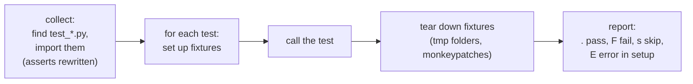

# Testing with pytest

> **Curriculum slug:** `testing-with-pytest` · **Written in:** M0 phase 1 · **Python version:** 3.15 (same on 3.13/3.14)
> **Prerequisites:** [How Python runs your code](how-python-runs-code.md), [Virtual environments and uv](virtual-environments-and-uv.md)
> **Time to read:** ~35 minutes

## 1. The one-sentence version

A **test** is a small function that runs a piece of our code and `assert`s the result is what the spec says, and **pytest** is the program that finds all those functions, runs them, and reports exactly which ones failed and why.

## 2. Why you should care

Tests are how we *know* Cartographer does what its specs promise, and they're how you can check that claim yourself without reading every line. Every acceptance criterion in a milestone spec maps to a named test (spec 05 §3.2). When a PR says "A-M0-02 passes", there's a test whose docstring says `A-M0-02`, and you can run it:

```text
uv run pytest -k three_entry_points -v
```

Tests also act as **executable documentation**: a test called `test_no_command_is_a_usage_error` tells you a behaviour in one line, and it can't go out of date without failing.

## 3. The idea, step by step

### Step 1: a test is a function whose name starts with `test_`

```python
# tests/unit/test_example.py
def add(a: int, b: int) -> int:
    return a + b

def test_add_two_numbers() -> None:
    assert add(2, 3) == 5
```

`uv run pytest` **discovers** files named `test_*.py`, collects functions named `test_*`, runs each one, and reports. A test passes if it finishes, and fails if an `assert` is false or any exception escapes.

### Step 2: `assert` and pytest's helpful failure messages

Plain Python `assert` only says `AssertionError`. pytest **rewrites** assert statements in test files as it imports them, so a failure shows the values involved:

```text
>       assert add(2, 2) == 5
E       assert 4 == 5
E        +  where 4 = add(2, 2)
```

Floating-point arithmetic is inexact, so comparing floats needs `pytest.approx`:

```pycon
>>> import pytest
>>> 0.1 + 0.2 == 0.3
False
>>> 0.1 + 0.2 == pytest.approx(0.3)
True
```

### Step 3: testing that something fails

When the *correct* behaviour is an exception, use `pytest.raises`. The block must raise the given exception, otherwise the test fails:

```pycon
>>> with pytest.raises(ZeroDivisionError):
...     1 / 0
>>> with pytest.raises(ValueError, match="invalid literal"):
...     int("twelve")
```

### Step 4: fixtures provide what a test needs

A **fixture** is a function that prepares something for a test: a temporary folder, a fake project, a loaded script. A test asks for a fixture by naming it as a parameter, and pytest calls the fixture and passes in the result. Built-in fixtures we use:

| Fixture | Gives you |
|---|---|
| `tmp_path` | A fresh, empty temporary folder (a `pathlib.Path`), different for every test |
| `capsys` | Captures what the code printed: `out, err = capsys.readouterr()` |
| `monkeypatch` | Temporarily replaces an attribute, env var or `sys.argv`, undone automatically afterwards |
| `pytester` | Runs pytest itself on a throwaway folder (used to test our `src/conftest.py`) |

Our own fixtures live in [`tests/conftest.py`](../../../tests/conftest.py), a file pytest loads automatically. For example `load_script` imports a file from `scripts/` so its functions can be tested.

```python
def test_missing_note_fails(check_concepts, tmp_path):   # two fixtures, injected by name
    ...
```

### Step 5: parametrize: one test, many inputs

```python
@pytest.mark.parametrize(("text", "expected"), [("CRT001", True), ("crt001", True), ("X1", False)])
def test_code_lookup(text, expected):
    assert (lookup(text) is not None) is expected
```

pytest runs it three times and reports each case separately (`test_code_lookup[CRT001]` …).

### Step 6: markers: labels that select or skip tests

A **marker** is a label attached with `@pytest.mark.<name>`. Ours are registered in `pyproject.toml`. With `--strict-markers` a typo in a marker name is an error, not a silently ignored label:

```pycon
>>> import tomllib, cartographer
>>> from pathlib import Path
>>> root = Path(cartographer.__file__).resolve().parents[2]
>>> pytest_ini = tomllib.loads((root / "pyproject.toml").read_text(encoding="utf-8"))["tool"]["pytest"]["ini_options"]
>>> [marker.split(":")[0] for marker in pytest_ini["markers"]]
['slow', 'network', 'docker', 'corpus', 'execute', 'requires_py314', 'requires_py315']
```

Three of them are **opt-in**. The default options contain `-m "not network and not docker and not corpus"`, so tests needing the internet, Docker or the cloned corpus repositories don't run unless you ask:

```text
uv run pytest -m docker        # a later -m REPLACES the default one, so this runs only docker tests
```

### Step 7: doctests: examples in docstrings are tests too

`--doctest-modules` (in our default options) makes pytest import every module in `src/` and run the `>>>` examples in its docstrings. If the docstring of `python_description` says

```text
>>> python_description((3, 15, 2), free_threaded=True)
'3.15.2, free-threaded'
```

then that line *is* a test. The concept notes you're reading are tested the same way, by [`tests/docs/test_concept_examples.py`](../../../tests/docs/test_concept_examples.py). Every `pycon` block on this page was run on Python 3.13, 3.14, 3.15 and 3.15t before it was committed.

### Step 8: coverage: which lines did the tests run?

`pytest --cov` records every line (and every branch of every `if`) the tests executed. **Line coverage** asks "was this line run?". **Branch coverage** asks "were both the `True` and `False` outcomes of this `if` taken?". Our gates are ≥ 90 % for `core/` and ≥ 85 % overall (spec 05 §3.2):

```text
uv run python scripts/dev.py test --gates
```

High coverage doesn't prove correctness. It only proves that code *ran*. A missing assert still passes. That's why every acceptance criterion also needs a specific named test.

### Step 9: golden files (arriving in M0 phase 4)

For command-line output, a **golden file** stores the expected output, for example `tests/golden/scan/m0_golden.txt`. The test runs the command and compares the result with the file. When the output changes on purpose, `uv run pytest --update-golden` rewrites the files, and the **diff in the PR** is then reviewed by a human. That review *is* the test.

## 4. How it really works (under the hood)



- **Import mode.** We use `--import-mode=importlib`: pytest imports each test file by its path *without* adding folders to `sys.path`. Two test files may then share a base name (`tests/unit/core/test_x.py` and `tests/unit/cli/test_x.py`), and tests can only import our package the way a user would.
- **`conftest.py`** files are plugins local to a folder. pytest loads every `conftest.py` from the root down to the test's folder. Ours registers Hypothesis profiles, skips version-specific tests, and tells pytest never to import `tests/fixtures/` (fixture projects are *data*, and many are deliberately broken).
- **`filterwarnings = ["error"]`** turns every warning into a test failure, because a warning from our own code is a bug we'd otherwise ignore.

## 5. Where Cartographer uses this

| File / function | How it's used |
|---|---|
| [`pyproject.toml`](../../../pyproject.toml) `[tool.pytest.ini_options]` | Default options, markers, warnings-as-errors, doctests |
| [`tests/conftest.py`](../../../tests/conftest.py) | Hypothesis profiles, collection rules, version markers, `load_script` |
| [`src/conftest.py`](../../../src/conftest.py) | Keeps `__main__.py` (and later sandbox scripts) out of doctest collection |
| [`tests/integration/test_cli_basics.py`](../../../tests/integration/test_cli_basics.py) | `capsys`, `monkeypatch`, `pytest.raises`, subprocess tests of the real commands |
| [`tests/docs/`](../../../tests/docs/test_docstrings.py) | Tests that enforce the documentation standard (spec 04 §8) |
| [`scripts/dev.py`](../../../scripts/dev.py) `test --gates` | Coverage gates |

## 6. Pitfalls

### Pitfall 1: a test that can't fail
`assert result` passes for any non-empty value. Assert the *specific* expected value. A good habit is to break the code on purpose once and watch the test fail. We do exactly that for each doc-check script ("a test of the test", T-M0-26).

### Pitfall 2: tests that depend on each other or on order
Each test must set up what it needs (fixtures) and leave nothing behind. Never rely on another test having run first.

### Pitfall 3: depending on the machine
Paths (`\` vs `/`), line endings, time, locale and the current directory all differ between machines. Our tests use `tmp_path`, posix-style relative paths and explicit `encoding="utf-8"`, and CI runs on both Windows and Linux to catch slips.

### Pitfall 4: catching too much with `pytest.raises(Exception)`
That passes for *any* error, including a typo-induced `NameError`. Name the exact exception type, and use `match=` for the message.

## 7. Version notes

- pytest itself supports every Python we test on. Behaviour is the same on 3.13–3.15t.
- On free-threaded builds (3.15t) tests run the same way. C4's stretch goal looks at running work in parallel threads.

## 8. Exercises

1. Run `uv run pytest -q`. Then run `uv run pytest -q -m slow`. What changed, and why?
   <details><summary>Answer</summary>

   The second run selects only tests marked `slow` (today, the pytester test of `src/conftest.py`). The `-m` you type replaces the default `-m "not network and not docker and not corpus"` from `pyproject.toml`.
   </details>

2. In [`tests/integration/test_cli_basics.py`](../../../tests/integration/test_cli_basics.py), why does `test_version_string_mentions_free_threaded_builds` use `monkeypatch` instead of running the test on a free-threaded Python?
   <details><summary>Answer</summary>

   So the test checks *both* outcomes on *every* interpreter. `monkeypatch.setattr(versions, "FREE_THREADED", True)` pretends to be a free-threaded build for the duration of the test, and pytest undoes it afterwards.
   </details>

3. 🖐 Write a failing test on purpose: copy `test_no_command_is_a_usage_error`, change `== 2` to `== 0`, and run it. Read the failure message. Which line of the output tells you the actual value? Then delete your copy.
   <details><summary>Answer</summary>

   The `E       assert 2 == 0` line, produced by pytest's assertion rewriting, shows the actual value (2) next to the expected one.
   </details>

## 9. Further reading

- Official docs: [pytest: getting started](https://docs.pytest.org/en/stable/getting-started.html) · [How to use fixtures](https://docs.pytest.org/en/stable/how-to/fixtures.html) · [Parametrizing](https://docs.pytest.org/en/stable/how-to/parametrize.html) · [Doctests](https://docs.pytest.org/en/stable/how-to/doctest.html)
- Python: [`doctest`](https://docs.python.org/3/library/doctest.html)
- Coverage: [coverage.py: branch coverage](https://coverage.readthedocs.io/en/latest/branch.html)
