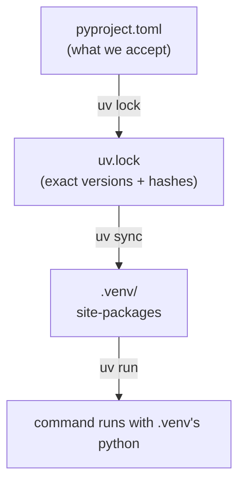

# Virtual environments and uv

> **Curriculum slug:** `virtual-environments-and-uv` · **Written in:** M0 phase 1 · **Python version:** 3.15 (same on 3.13/3.14)
> **Prerequisites:** [Project layout and `pyproject.toml`](project-layout-and-pyproject.md)
> **Time to read:** ~20 minutes

## 1. The one-sentence version

A **virtual environment** (venv) is a folder containing its own `site-packages` where one project's dependencies get installed, isolated from every other project, and **uv** is the tool that creates it, fills it from a **lockfile**, and runs commands inside it.

## 2. Why you should care

Without isolation, every project on your machine shares one set of installed packages. Project A needs `pytest 9`, project B needs `pytest 7`, and one of them breaks. Worse, "it works on my machine" happens because *your* machine has some package installed that CI doesn't.

Cartographer uses `uv` so that:

- your environment, CI's environment and any future contributor's are **byte-for-byte the same** versions (from `uv.lock`);
- you never type `activate`, because `uv run <command>` always runs inside the right environment;
- testing on another Python is one flag: `uv run --python 3.13 pytest`.

## 3. The idea, step by step

### Step 1: where packages live

Every Python installation has a `site-packages` folder. `import pytest` finds pytest there:

```pycon
>>> import sysconfig
>>> from pathlib import Path
>>> Path(sysconfig.get_paths()["purelib"]).name
'site-packages'
>>> import pytest
>>> "site-packages" in Path(pytest.__file__).parts
True
```

### Step 2: a venv is a second `site-packages` with a pointer to a Python

A virtual environment is a folder (ours is `.venv/` in the repo root) with:

- `pyvenv.cfg`: a small text file saying which real Python this environment is based on;
- `Scripts/python.exe` on Windows (`bin/python` elsewhere): a launcher for that Python;
- `Lib/site-packages/` (Windows) or `lib/python3.15/site-packages/` (Linux/macOS): this project's packages only.

When Python starts from a venv, `sys.prefix` (where *this* environment is) differs from `sys.base_prefix` (where the *real* Python is installed). The examples on this page run inside our `.venv`, so:

```pycon
>>> import sys
>>> sys.prefix != sys.base_prefix
True
```

### Step 3: the lockfile pins every version

`pyproject.toml` says what we *accept*, for example `pytest>=9.2` ("9.2 or newer"). That's right for a library, but it means two people installing on different days could get different versions.

`uv.lock` records exactly which version of **every** package, including dependencies of dependencies, was chosen, with hashes of the files. `uv sync` installs exactly that. **The lockfile is committed to git**, which is how CI gets the same versions as you.

You can ask the environment which version it has:

```pycon
>>> from importlib.metadata import version
>>> import cartographer
>>> version("cartographer-py") == cartographer.__version__
True
```

`importlib.metadata` reads the installed package's `METADATA` file. That's the same information `uv` and `pip` use.

### Step 4: the uv commands you'll use

| Command | What it does |
|---|---|
| `uv python install 3.13 3.14 3.15 3.15t` | Download standalone Python builds (kept separate from any Python you installed yourself) |
| `uv sync` | Create `.venv/` if needed and make it match `uv.lock` exactly: install, upgrade, and *remove* anything extra |
| `uv run <cmd>` | Sync first (if needed), then run `<cmd>` inside `.venv/`. For example `uv run pytest` or `uv run cartographer --version` |
| `uv run --python 3.13 <cmd>` | Same, but with Python 3.13. uv rebuilds `.venv/` for that version |
| `uv lock` | Re-resolve and rewrite `uv.lock` after you change `pyproject.toml` |
| `uv lock --upgrade` | Move every package to the newest allowed version (done deliberately, in its own PR, spec 05 §5) |
| `uvx <tool>` | Run a tool in a throwaway environment without adding it to the project (C4 uses this for pyright, pyrefly and ty) |

### Step 5: which Python?

`.python-version` in the repo root contains `3.15`. uv reads it to choose the default interpreter. The project's `requires-python = ">=3.13"` is the *range* we support. CI tests all four (3.13, 3.14, 3.15, 3.15t).

## 4. How it really works (under the hood)



- **Resolution** (`uv lock`) is a puzzle: find one version of every package that satisfies everyone's constraints. uv solves it with a fast solver written in Rust.
- **Installation** (`uv sync`) downloads wheels into a global cache and *links* them into `.venv/`. That's why a second project using the same packages installs almost instantly.
- **Activation**, the `activate` script you may have seen in tutorials, only edits your shell's `PATH` so `python` means the venv's Python. `uv run` makes that unnecessary, because it calls the venv's interpreter directly.
- **Your Python 3.12** (installed before this project) is untouched. uv's interpreters live in `%APPDATA%\uv\python\`.

## 5. Where Cartographer uses this

| File / function | How it's used |
|---|---|
| [`uv.lock`](../../../uv.lock) | The exact dev environment, committed |
| [`.python-version`](../../../.python-version) | Default interpreter: 3.15 |
| [`scripts/dev.py`](../../../scripts/dev.py) | Runs every tool as `sys.executable -m <tool>`, so the tools always come from the locked environment |
| [`.github/workflows/ci.yml`](../../../.github/workflows/ci.yml) | `uv python install` + `uv sync --python …` on each of the 8 CI cells |

## 6. Pitfalls

### Pitfall 1: running `python` instead of `uv run python`
Plain `python` in a new terminal may be your system Python 3.12, which has none of our dependencies. The symptom is `ModuleNotFoundError: No module named 'hypothesis'`. Use `uv run`.

### Pitfall 2: editing `uv.lock` by hand
Never do this. Change `pyproject.toml`, then run `uv lock`.

### Pitfall 3: `pip install` into the project environment
It works, but the next `uv sync` *removes* anything not in the lockfile. Add dependencies with `uv add` (or by editing `pyproject.toml` and running `uv lock`).

### Pitfall 4: switching interpreters rebuilds the venv
`uv run --python 3.13 …` and then `uv run …` (3.15) each rebuild `.venv/`. It's quick thanks to the cache, but don't be surprised by the "Installed N packages" message.

## 7. Version notes

- `venv` has been in the standard library since 3.3. uv creates compatible environments.
- Free-threaded interpreters (`3.15t`) need packages built for them. Pure-Python packages work everywhere, while C extensions need a matching `cp315t` wheel. That's why CI checks this build separately (D-029).

## 8. Exercises

1. Open `.venv/pyvenv.cfg` in an editor. Which line tells you which real Python the environment uses?
   <details><summary>Answer</summary>

   The `home = …` line, the folder of the base interpreter. You'll also see `version_info = 3.15.x`.
   </details>

2. Run `uv run python -c "import sys; print(sys.executable)"`. Then run plain `python -c "import sys; print(sys.executable)"` in the same terminal. Why do they differ?
   <details><summary>Answer</summary>

   `uv run` uses `.venv/Scripts/python.exe`. Plain `python` is whatever comes first on your `PATH`, probably the Python 3.12 you had before.
   </details>

3. Why is committing `uv.lock` right for this project, but a *library's* `pyproject.toml` still uses ranges (`>=`) instead of exact versions?
   <details><summary>Answer</summary>

   The lockfile pins the environment for *developing and testing* this repository. When someone installs `cartographer-py` into *their* project, their installer must be free to pick versions compatible with their other packages. Exact pins in a library cause unsolvable conflicts.
   </details>

## 9. Further reading

- Official docs: [`venv`](https://docs.python.org/3/library/venv.html) · [`sys.prefix`](https://docs.python.org/3/library/sys.html#sys.prefix) · [`importlib.metadata`](https://docs.python.org/3/library/importlib.metadata.html)
- uv: [Projects guide](https://docs.astral.sh/uv/guides/projects/) · [Python versions](https://docs.astral.sh/uv/concepts/python-versions/) · [Lockfile](https://docs.astral.sh/uv/concepts/projects/layout/#the-lockfile)
- PEP: [PEP 405 (virtual environments)](https://peps.python.org/pep-0405/)
