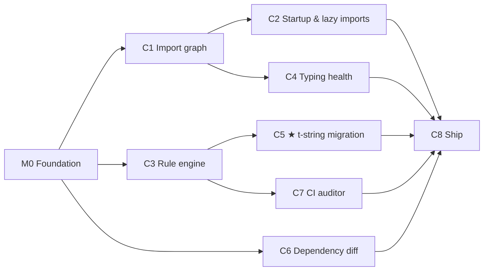

# 07 — Roadmap and milestone process

> The order of work, what depends on what, and the exact ritual for starting and finishing each milestone.

---

## 1. Milestones and dependencies

**Planned order (do them in this sequence):** M0 → C1 → C2 → C3 → C4 → C5 → C6 → C7 → C8.

The graph shows C3 and C6 only *need* M0, and C7 needs M0 + C3 (suppressions, CRT004, the `class-registries` concept note). For variety you may pull C7 forward to right after C3. In that case, C7 writes any C5-owned concept notes it needs (`injection-attacks`, `dataflow-and-taint`) as short stubs, and C5 later expands them. Don't start two milestones at once. Finishing one, write-up included, is worth more than two half-done.

| ID | Spec | Size | Version at end | Hard dependencies |
|---|---|---|---|---|
| M0 | [M0-foundation.md](milestones/M0-foundation.md) | M | 0.0.1 | — |
| C1 | [C1-import-graph.md](milestones/C1-import-graph.md) | L | 0.1.0 | M0 |
| C2 | [C2-startup-lazy-imports.md](milestones/C2-startup-lazy-imports.md) | L | 0.2.0 | C1 (resolver, module index) |
| C3 | [C3-rule-engine.md](milestones/C3-rule-engine.md) | M | 0.3.0 | M0 |
| C4 | [C4-typing-health.md](milestones/C4-typing-health.md) | M | 0.4.0 | C1 (module order for leak propagation) |
| C5 | [C5-tstring-migration.md](milestones/C5-tstring-migration.md) | XL | 0.5.0 | C3 (findings run through the engine; suppressions) |
| C6 | [C6-dependency-diff.md](milestones/C6-dependency-diff.md) | XL | 0.6.0 | M0 |
| C7 | [C7-ci-auditor.md](milestones/C7-ci-auditor.md) | M | 0.7.0 | M0, C3 (suppression providers D-051, CRT004, `class-registries` note) |
| C8 | [C8-ship.md](milestones/C8-ship.md) | M | 1.0.0 | all |

## 2. The milestone ritual

Each milestone goes through these stages in this order. Skipping stages defeats the learning goal (research "How to work through each milestone").

### Stage A: Prepare (owner, about 1 hour)
1. Read the milestone spec's **"Why this matters"** section and the research incident it cites.
2. Read the concept notes listed under **"Read before starting"**. Notes written in earlier milestones exist already. New ones get written in Stage B, and you read them as they land.
3. Answer the **prediction questions** in `docs/learn/predictions/<milestone>.md`, using [the template](../templates/prediction.md). Write what you *expect*, even if you're guessing. Wrong predictions are where the learning happens. **The implementer may not start Stage B until this file exists** (it can be short).

### Stage B: Build (implementer, phase by phase)
1. One branch + PR per **phase** listed in the spec.
2. Within a phase, write the concept notes *first* (or alongside), then code + docstrings + tests together.
3. Each PR follows 04 §6 (including "What you'll learn"). The owner reviews, and questions go into the FAQ.
4. **Don't read the reference implementation's source** (D-008).

### Stage C: Accept (implementer + owner)
1. Run every acceptance criterion (`A-…` IDs in the spec) and record the results.
2. Run on the acceptance corpus if the milestone specifies it.
3. Write the walkthrough (layer 3).

### Stage D: Reflect
1. Milestone write-up (layer 4), including prediction vs. reality.
2. Reference comparison (layer 5): *now* read the reference implementation.
3. Any "we'd change this" items become issues, or decisions if they change the spec.

### Stage E: Close
1. Bump the version (D-010) and update `CHANGELOG.md`.
2. Tag `vX.Y.Z` (local tag; pushing needs the owner's go-ahead).
3. Tick the milestone in §3 below and in the curriculum index.

## 3. Progress tracker

| ID | Predictions | Phases merged | Accepted | Walkthrough | Write-up | Comparison | Version |
|---|---|---|---|---|---|---|---|
| M0 | ☐ | ☐ | ☐ | ☐ | ☐ | n/a | ☐ |
| C1 | ☐ | ☐ | ☐ | ☐ | ☐ | ☐ | ☐ |
| C2 | ☐ | ☐ | ☐ | ☐ | ☐ | ☐ | ☐ |
| C3 | ☐ | ☐ | ☐ | ☐ | ☐ | ☐ | ☐ |
| C4 | ☐ | ☐ | ☐ | ☐ | ☐ | ☐ | ☐ |
| C5 | ☐ | ☐ | ☐ | ☐ | ☐ | ☐ | ☐ |
| C6 | ☐ | ☐ | ☐ | ☐ | ☐ | ☐ | ☐ |
| C7 | ☐ | ☐ | ☐ | ☐ | ☐ | ☐ | ☐ |
| C8 | ☐ | ☐ | ☐ | ☐ | ☐ | ☐ | ☐ |

## 4. Structure of every milestone spec

All milestone specs share the same sections, so you always know where to look:

1. **Summary**: one paragraph, plain English.
2. **Why this matters**: the incident, told for a beginner.
3. **Read before starting**: concept notes + prediction questions.
4. **Scope**: in / out (and *why* out).
5. **User-facing behaviour**: commands, options, example output (exact).
6. **Design**: modules, data structures, algorithms (pseudocode), edge cases.
7. **Diagnostics**: codes from 03 §6, with trigger conditions and the `data` fields.
8. **Configuration**: the `[tool.cartographer.<section>]` keys.
9. **Phases & tasks**: ordered, each phase = one PR, with 🖐 hands-on candidates marked.
10. **Test plan**: `T-<ms>-NN` items.
11. **Acceptance criteria**: `A-<ms>-NN` items, all objectively checkable.
12. **Documentation deliverables**: concept notes, walkthrough, write-up, comparison specifics.
13. **Reference implementations to compare after**: and the questions to answer.
14. **Risks & open items**: links to spikes in [08](08-spikes-and-risks.md).
15. **Exercises for the learner**: optional, with hints.
