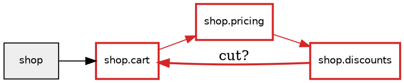

# C1: Import graph

> **Size:** L · **Version at end:** `0.1.0` · **Depends on:** M0 · **Unblocks:** C2 (resolver, module index), C4 (module order)
> **Incident:** Dropbox's import "tangle" (research §2.3)
> **Spikes in this milestone:** S-07 (phase 1)
> **Command:** `cartographer graph` · **Codes:** CRT101–CRT106 · **Config:** `[tool.cartographer.graph]`

---

## 1. Summary

C1 teaches Cartographer to answer **"which modules import which?"** It reads every Python file in a project, finds every `import` statement (including imports hidden inside functions, `if TYPE_CHECKING:` blocks, `try/except ImportError` blocks, and calls like `importlib.import_module("x")`), and **resolves** each one to a module the way Python's import system would. The result is a **directed graph**: modules are nodes, and an edge from A to B means "A imports B".

On that graph C1 finds **import cycles**. It uses Tarjan's algorithm to find *strongly connected components* (SCCs), groups of modules that can all reach each other. It flags very large cycles as **tangles**, **suggests which edges to cut** to break each cycle (with reasoning), checks **layer contracts** ("`core` must never import `cli`"), and exports the graph as **Graphviz DOT** or **Mermaid** so you can see it. Cartographer then runs this on its own source in CI. That's dogfooding: the layering rules in [02 §3](../02-architecture.md#3-module-dependency-rules-layering) become an automated check.

## 2. Why this matters

### The incident (research §2.3)
Dropbox grew from about 420,000 type-annotated lines to almost 4 million in three years. Their type checker (mypy) slowed down badly: clean runs took over 15 minutes. One major reason was a **"tangle" of several hundred modules in import cycles**. When modules form a cycle, a tool can't check them one at a time in dependency order, because every module in the cycle depends on every other. A change to any one of them invalidates them all, so incremental runs took about a minute instead of seconds.

### Why cycles hurt even without a type checker
Python runs a module's code the first time it is imported. If `a.py` imports `b.py` and `b.py` imports `a.py`, then while `a` is half-way through running, `b` starts and asks for `a`, and gets the **partially initialised** `a` from `sys.modules`. If `b` needs a name that `a` hasn't defined yet, you get the famous

```text
ImportError: cannot import name 'X' from partially initialized module 'a' (most likely due to a circular import)
```

Cycles also make code harder to understand, test and split into packages. They are the main obstacle when a company wants to break a monolith apart.

### What you will learn
How Python's import system *really* finds and runs modules (finders, `sys.modules`, packages, namespace packages, relative imports); what makes an import happen "at import time" versus later; graph theory's most useful algorithm for this problem (SCCs); and why finding the *smallest* set of edges to cut is a famously hard problem (NP-hard), which is why real tools use heuristics.

## 3. Read before starting

### 3.1 Concept notes
- From M0: `ast-basics`, `paths-and-files`, `dataclasses-and-enums`, `property-based-testing`, `config-with-tomllib`.
- Written in this milestone (read them as they land): `import-system`, `circular-imports`, `type-checking-guard`, `graphs-and-scc`, `breaking-cycles`, `graph-visualisation`.

### 3.2 Prediction questions
Answer in `docs/learn/predictions/C1.md` before phase 1.

1. `a.py` contains `import b`, and `b.py` contains `import a`. Neither uses the other's names at the top level. What happens when you run `python -c "import a"`: an error, or nothing?
2. Same files, but `b.py` contains `from a import X` and `X` is defined at the *bottom* of `a.py`. Now what happens?
3. Does `import a.b.c` run the code in `a/__init__.py`? In `a/b/__init__.py`?
4. Does an `import` written *inside a function* run when the module is imported, or later?
5. What is the value of `typing.TYPE_CHECKING` when your program runs normally?
6. A directory has `.py` files but no `__init__.py`. Can you still import from it?
7. How many import cycles do you expect in a mature, well-known library with about 200 modules: 0, 1–5, or more than 5?
8. Given a cycle `a → b → c → a`, how would *you* decide which import to remove?
9. If a recursive algorithm walks a chain of 5,000 modules, one call per module, what happens in Python? (Hint: `sys.getrecursionlimit()`.)
10. Is finding the **minimum** number of imports to remove so there are no cycles left an easy problem for a computer? Guess: seconds, hours, or "nobody knows a fast way"?

## 4. Scope

### 4.1 In scope
- Source-root detection and the full module index (§6.1, §6.2).
- Import extraction for `import`, `from … import`, `from … import *`, `importlib.import_module("literal")` and `__import__("literal")`, with **edge kinds** (§6.3).
- Resolution: absolute, relative (any level), submodule-vs-attribute, implicit ancestor packages, namespace packages, stubs, extension modules, stdlib/external classification (§6.4).
- Graph model, iterative Tarjan SCC, representative cycles, tangles (§6.5–6.7).
- Cut suggestions by a documented greedy heuristic + minimality pass (§6.8).
- Layer and forbidden-import contracts (§6.9).
- Exports: text summary, JSON, SARIF, DOT, Mermaid; `--focus/--depth/--direction`, `--cycles-only` (§5, §6.10).
- Dogfooding on the repo root `.` in CI (D-048; the repo's `[tool.cartographer] exclude` keeps `tests/fixtures/**` out). Acceptance corpus selection (S-07) and `scripts/fetch_corpus.py`.

### 4.2 Out of scope (and why)
| Not in C1 | Why |
|---|---|
| Transitive contract checking (import-linter checks *chains*, A → x → B) | Direct edges only in v1, which keeps the algorithm simple. Noted for the comparison write-up |
| Resolving imports of *installed* third-party packages into their internals | We don't inspect `site-packages` (static, project-only). External packages are single nodes |
| Executing code to discover imports (e.g. plugin loading at runtime) | Static by default (D-013). Only the oracle test executes our *own generated* fixture |
| `sys.path` manipulation in code (`sys.path.insert(0, …)`) | Not statically resolvable in general. C2 flags it as a side effect |
| Non-literal dynamic imports (`import_module(name)`) | Counted in `stats.dynamic_unresolved`, not resolved |
| `.gitignore`-aware discovery | D-020 |
| Incremental graph caching | NG3 |

## 5. User-facing behaviour

### 5.1 Command
```
cartographer graph [PATH]
    [--edge-kinds KINDS]          # comma list of module,optional,dynamic,deferred,typing, or "all";
                                  # overrides graph.cycle-edge-kinds for cycle detection
    [--include-external]          # include stdlib/external nodes in payload and exports
    [--focus MODULE] [--depth N] [--direction {out,in,both}]   # N default 2, direction default both
    [--cycles-only]               # payload/exports contain only modules in cycles (and edges among them)
    [--no-cuts]                   # skip CRT105 suggestions
    [--format {text,json,sarif,dot,mermaid}]
```
Global options from 03 §1.1 apply. In `dot` and `mermaid` formats **only the graph is printed** to stdout. Diagnostics still determine the exit code, and an INFO log line reports their count.

### 5.2 Worked example: fixture `c1_shop`
```
tests/fixtures/projects/c1_shop/
├── README.md
├── pyproject.toml                 # [project] name = "shop"
└── src/shop/
    ├── __init__.py                # from .cart import Cart
    ├── cart.py                    # from shop.pricing import price
    │                              # DEFAULT_PRICE = price(0)          ← used at module level
    ├── pricing.py                 # from shop import discounts
    │                              # RATE = discounts.RATE            ← used at module level
    └── discounts.py               # import shop.cart
                                   # RATE = 0.1
                                   # def best(c): return shop.cart.Cart(c)   ← used only in a function
```
```text
PS> uv run cartographer graph tests/fixtures/projects/c1_shop
src/shop/cart.py:1:1: CRT101 [warning] import cycle of 3 modules: shop.cart → shop.pricing → shop.discounts → shop.cart
  help: break the cycle at the cheapest edge (see CRT105 below); run `cartographer explain CRT101` for fixes
  related: src/shop/pricing.py:1:1 (shop.pricing imports shop.discounts)
  related: src/shop/discounts.py:1:1 (shop.discounts imports shop.cart)
src/shop/discounts.py:1:1: CRT105 [info] cut shop.discounts → shop.cart to break the cycle: 1 use, only inside functions
  help: move `import shop.cart` into the function that uses it (on Python 3.15 you could make it `lazy import shop.cart`, see C2)

Import graph: 4 modules in 1 source root (src), 4 internal edges, 0 external packages, 0 stdlib modules
Cycles: 1 (sizes: 3) · tangles: 0 · contract violations: 0

Found 0 errors, 1 warning, 1 info in 4 files (0.02 s).
```
- The payload lines are printed by the `payload_text` hook (M0 §6.16), after the diagnostics and before the summary.
- The **CRT101 location** is the first import site of the first edge in the representative cycle (§6.7).

### 5.3 JSON payload (`--format json`, field `payload`)
```json
{
  "source_roots": [{"path": "src", "detected_by": "src-dir"}],
  "cycle_edge_kinds": ["module", "optional", "dynamic"],
  "nodes": [
    {"name": "shop", "kind": "package", "path": "src/shop/__init__.py"},
    {"name": "shop.cart", "kind": "module", "path": "src/shop/cart.py"}
  ],
  "edges": [
    {"source": "shop.discounts", "target": "shop.cart", "kind": "module",
     "sites": [{"path": "src/shop/discounts.py", "line": 1, "column": 1,
                "statement": "import shop.cart", "names": [], "kind": "module",
                "mechanism": "import", "implicit": false}]}
  ],
  "sccs": [{"members": ["shop.cart", "shop.discounts", "shop.pricing"],
            "cycle": ["shop.cart", "shop.pricing", "shop.discounts", "shop.cart"],
            "tangle": false}],
  "cuts": [{"source": "shop.discounts", "target": "shop.cart", "cost": 0.25, "uses": 1,
            "reason": "functions", "scc": 0}],
  "contracts": []
}
```
`nodes` and `edges` are sorted (by name, then by `(source, target)`). External and stdlib nodes appear only with `--include-external`. `stats`: `files_analyzed`, `modules`, `internal_edges`, `external_packages`, `stdlib_modules`, `sccs`, `dynamic_unresolved`, `duration_s`.

### 5.4 DOT (`--format dot`)

Style rules: packages filled grey; nodes in a cycle red with `penwidth=2`; edges inside an SCC red; a suggested cut gets `style=bold, label="cut?"`; `deferred` edges `style=dashed`; `typing` edges `style=dotted`; `optional` edges `arrowhead=empty`; `dynamic` edges `arrowhead=odot`; external/stdlib nodes `shape=ellipse, style=dashed`. All IDs are double-quoted with `"` and `\` escaped. Lines are sorted (node lines first, then edge lines).

### 5.5 Mermaid (`--format mermaid`)
```text
flowchart LR
  n0["shop"]
  n1["shop.cart"]
  n2["shop.discounts"]
  n3["shop.pricing"]
  n0 --> n1
  n1 --> n3
  n2 -->|cut?| n1
  n3 --> n2
  classDef cycle stroke:#d62728,stroke-width:2px
  class n1,n2,n3 cycle
  linkStyle 1,2,3 stroke:#d62728
```
Node IDs are `n0…nK` in sorted-name order. Labels are quoted, with `"` replaced by `#quot;`. `deferred`/`typing` edges use `-.->`, with `typing` labelled `-.->|typing|`. If the output has more than 400 edges, a WARNING log suggests `--focus`, because large Mermaid diagrams may not render on GitHub.

### 5.6 Focus
`cartographer graph --focus shop.pricing --depth 1` keeps `shop.pricing` plus every node within 1 hop along displayed edges (`--direction both`). Payload, exports and the text listing are restricted to that subgraph. **Diagnostics are kept only if their location or any related location is in a file of a focused module.** An unknown module → `UsageError: unknown module "shop.pricng"; did you mean "shop.pricing"?` (exit 2).

## 6. Design

### Package layout
```
src/cartographer/graph/
  __init__.py     # public API: exactly the names listed in §6.12 (other features import only these)
  config.py       # GraphConfig, ContractConfig (import-light: dataclasses only)
  index.py        # ModuleIndex: every internal module, package, namespace package, stub, extension
  extract.py      # ImportVisitor: AST → ImportSite (with context/guard/mechanism)
  resolve.py      # Resolver: ImportSite → target module name(s) + classification; CRT103/CRT104
  model.py        # ModuleNode, ImportSite, ImportEdge, ImportGraph
  build.py        # build_import_graph(project, config) -> Result[ImportGraph]
  scc.py          # iterative Tarjan
  cycles.py       # representative cycles, tangles, CRT101/CRT102
  usage.py        # how much the importer uses an edge (for cut costs)
  cuts.py         # weighted greedy feedback-edge heuristic + minimality pass; CRT105
  contracts.py    # layers/forbidden contracts; CRT106
  export.py       # DOT + Mermaid renderers (registered with output.registry)
  focus.py        # neighbourhood subgraph
  query.py        # condensation_order, fan_in (§6.12; used by C4)
src/cartographer/core/modnames.py   # EXTENDED: detect_source_roots (see Source roots)
src/cartographer/cli/commands/graph.py
src/cartographer/api.py             # + build_import_graph
scripts/fetch_corpus.py  corpus/corpus.toml
benchmarks/bench_graph.py
```
`cli/sections.py` gains `"graph": "cartographer.graph.config:GraphConfig"`.

### 6.1 Source roots

A **source root** is a directory that would be on `sys.path` when the project runs: the directory *containing* the top-level packages. With `src/shop/__init__.py`, the source root is `src`, and the module is `shop`, not `src.shop`. Getting this wrong shifts every module name and breaks every resolution, so it comes first.

`core/modnames.py` gains (it lives in `core`, because `Project.source_roots` is a core concept, 02 §4.6):
```python
@dataclass(frozen=True, slots=True)
class SourceRoot:
    path: str              # posix, relative to project root; "." for the root itself
    detected_by: Literal["config", "pyproject:setuptools", "pyproject:hatch", "pyproject:poetry",
                         "pyproject:uv", "src-dir", "root"]

def detect_source_roots(root: Path, pyproject: Mapping[str, object] | None,
                        configured: Sequence[str]) -> tuple[SourceRoot, ...]
```
**Algorithm (first rule that yields at least one root wins):**
1. **Config.** `source-roots` non-empty → those, in order. Each must be an existing directory under the root, else `ConfigError`.
2. **Build-backend hints in `pyproject.toml`.** All found hints are combined, de-duplicated, in this order:
   - setuptools: `[tool.setuptools.packages.find] where = [...]`. `[tool.setuptools] package-dir = {"" = "src"}` → the value for key `""`.
   - hatch: `[tool.hatch.build.targets.wheel] packages = ["src/shop", …]` → the **parent** directory of each entry (`src`). An entry without a `/` → `.`.
   - poetry: `[tool.poetry] packages = [{include = "shop", from = "src"}, …]` → `from`, or `.` when absent.
   - uv: `[tool.uv.build-backend] module-root = "src"` → that value. (When `build-system.build-backend == "uv_build"` and `module-root` is absent, use `src`. *The implementer verifies uv_build's documented default and comments the source.*)
   - A hinted directory that doesn't exist is ignored with a WARNING log.
3. **`src/` directory.** If `<root>/src` is a directory containing at least one `.py` file or package directory (at any depth ≤ 2) → `("src",)`.
4. **Root.** Otherwise `(".",)`.

**Validation:**
- **Nested roots** (one root inside another, e.g. `.` and `src`) → `ConfigError` when configured explicitly. When they come from build-backend hints, the **outer** root is dropped with a WARNING and the **inner** one is kept, because the inner directory is the one that holds the top-level packages in a src layout.
- **Duplicate top-level names across roots** (`a/shop/` and `b/shop/`): both are indexed; `ModuleIndex` lookup returns the one from the **earlier root**, just as Python's `sys.path` order would. INFO log `module "shop" found in source roots a and b; using a`.
- `tests/` is never auto-added as a root. In flat layout, `tests/test_x.py` becomes module `tests.test_x` (as a namespace-package portion if there's no `__init__.py`). That's what pytest's default rootdir import mode does too.
- Files outside every root, or with non-identifier path parts (M0 §6.11 rule 4), get `module = None` and are **scripts** (§6.2).

`core/project.load_project` switches from `default_source_roots` to `detect_source_roots`. M0's tests for flat and src layouts must still pass unchanged.

### 6.2 Module index (`graph/index.py`)
```python
class NodeKind(enum.StrEnum):
    MODULE = "module"            # a .py file (not __init__)
    PACKAGE = "package"          # a directory with __init__.py (node path = the __init__.py)
    NAMESPACE = "namespace"      # a directory without __init__.py that contains modules (PEP 420)
    STUB = "stub"                # a .pyi with no matching .py
    EXTENSION = "extension"      # a compiled module (.pyd/.so) inside the project
    SCRIPT = "script"            # a .py file with no module name
    STDLIB = "stdlib"            # top-level stdlib module, e.g. "os"
    EXTERNAL = "external"        # top-level third-party name, e.g. "requests"

@dataclass(frozen=True, slots=True)
class ModuleNode:
    name: str                    # dotted name; scripts use "script:<relpath>"
    kind: NodeKind
    path: str | None             # posix relpath of the file; namespace -> directory path
    is_package: bool             # PACKAGE or NAMESPACE
    has_stub: bool = False       # a .pyi sits next to the .py

class ModuleIndex:
    def __init__(self, project: Project) -> None
    def get(self, dotted: str) -> ModuleNode | None
    def top_level_names(self) -> frozenset[str]
    def is_internal_top(self, name: str) -> bool
    def nodes(self) -> Iterable[ModuleNode]                # sorted
```
**Building rules:**
1. Every `SourceFile` with a module name contributes a node. `pkg/__init__.py` → `PACKAGE "pkg"`. `pkg/__main__.py` → `MODULE "pkg.__main__"`.
2. `.py` and `.pyi` for the same name: one `MODULE`/`PACKAGE` node with `has_stub=True`, pointing at the `.py`. The `.pyi`'s imports are **ignored** for the graph, because stubs describe types, not runtime behaviour. `.pyi` alone → `STUB` node. Its imports become edges with guard `type-checking` (kind `typing`).
3. Every directory between a source root and a module that has **no** `__init__.py` becomes a `NAMESPACE` node (`path` = directory). That applies only when it contains (directly or deeper) at least one indexed module.
4. **Extension modules:** the walker in M0 only includes `*.py`/`*.pyi`. C1 additionally scans each package directory for `*.pyd` and `*.so` files and names them by the part **before the first dot** (`_speedups.cpython-315-x86_64-linux-gnu.so` → `_speedups`). They become `EXTENSION` nodes with no outgoing edges. They only exist so that `from pkg import _speedups` resolves instead of reporting CRT103.
5. Scripts: `SCRIPT` nodes named `script:<relpath>`. Their imports are extracted and resolved (and can produce CRT103/CRT104), but scripts can never be imported, so they're never in a cycle. They're hidden from payload/exports unless `graph.include-scripts = true`.

### 6.3 Import extraction (`graph/extract.py`)
```python
class Context(enum.StrEnum):   MODULE = "module"; FUNCTION = "function"
class Guard(enum.StrEnum):     NONE = "none"; TYPE_CHECKING = "type-checking"; IMPORT_ERROR = "import-error"
class Mechanism(enum.StrEnum): IMPORT = "import"; FROM = "from"; STAR = "star"; DYNAMIC = "dynamic"

class EdgeKind(enum.StrEnum):
    MODULE = "module"       # runs at import time, unconditionally or under a plain if/with/for
    OPTIONAL = "optional"   # runs at import time inside try/except ImportError (or its handler)
    DYNAMIC = "dynamic"     # importlib.import_module / __import__ with a literal, at import time
    DEFERRED = "deferred"   # inside a function body: runs only when the function is called
    TYPING = "typing"       # inside `if TYPE_CHECKING:` (never runs) or from a stub

@dataclass(frozen=True, slots=True)
class RawImport:               # what the visitor records, before resolution
    location: Location
    statement: str             # first source line of the statement, max 120 chars
    mechanism: Mechanism
    module: str | None         # "a.b" for `import a.b` / `from a.b import c`; None for `from . import c`
    level: int                 # 0 = absolute; dots count for relative
    names: tuple[str, ...]     # imported names for from-imports; () otherwise; ("*",) for star
    bound: tuple[str, ...]     # names this statement binds in the importer (aliases applied)
    context: Context
    guard: Guard

def kind_of(context: Context, guard: Guard, mechanism: Mechanism) -> EdgeKind:
    """Precedence: typing > deferred > dynamic > optional > module."""
```
**Visitor rules (`ImportVisitor(ast.NodeVisitor)`):**
- **Function context:** only the **body** of `FunctionDef`/`AsyncFunctionDef`/`Lambda` is visited in `FUNCTION` context. **Decorators, default values, and annotations are visited in the *enclosing* context**, because Python evaluates them when the `def` statement runs, at import time for a module-level function. (Annotations: unless deferred by PEP 649 on 3.14+ or `from __future__ import annotations`. For *import extraction* this rarely matters, since an import can't appear inside an annotation, but `__import__("x")` in a default can.) Class bodies run at import time, so they keep the enclosing context. Method bodies are `FUNCTION`.
- **`TYPE_CHECKING` guard:** an `if` whose test is exactly `TYPE_CHECKING`, or `X.TYPE_CHECKING` where `X` is bound to `typing`/`typing_extensions` in this module → body is `TYPE_CHECKING`, `orelse` keeps the outer guard. `if not TYPE_CHECKING:` → the reverse. Any other test (`if TYPE_CHECKING and sys.version_info…`) → treated as a plain `if` (both branches `NONE`). That's a documented limitation.
- **ImportError guard:** a `try` (or `try`/`except*`) where any handler catches `ImportError`, `ModuleNotFoundError`, `Exception` or `BaseException` (by bare name or `builtins.` attribute, alone or in a tuple), or is a bare `except:` → imports in the **`try` body and in every handler body** get `IMPORT_ERROR`. `else`/`finally` keep the outer guard.
- Nested guards: `TYPE_CHECKING` wins over `IMPORT_ERROR`.
- `if __name__ == "__main__":` blocks are visited normally (context `MODULE`), but every `RawImport` inside gets `context=FUNCTION`. That block doesn't run on import, and treating it like a function body gives it the `deferred` kind. Commented as a deliberate modelling choice.
- **Dynamic imports:** a `Call` whose function is `importlib.import_module` (via `import importlib`, `import importlib as il`, or `from importlib import import_module [as x]`) or the bare name `__import__`, with a first positional argument that is a `str` constant:
  - Leading dots in the string → relative: `level = count of leading dots`. The base package comes from the second argument: the name `__package__` → the importer's package; the name `__name__` → the importer's own module name (that's `importlib.util.resolve_name` semantics); a string constant → that string. Anything else → unresolved.
  - `__import__("a.b")` is modelled like `import a.b`. Its `fromlist` argument is ignored.
  - A non-literal argument → no `RawImport`; `stats.dynamic_unresolved += 1`.
- `from __future__ import …` → not recorded.
- `bound` names: `import a.b.c` binds `a`; `import a.b.c as x` binds `x`; `from m import y as z` binds `z`; star binds nothing known.

### 6.4 Resolution (`graph/resolve.py`)
```python
@dataclass(frozen=True, slots=True)
class Target:
    module: str                 # dotted name of the node the edge points to
    implicit: bool              # True for ancestor-package edges

@dataclass(frozen=True, slots=True)
class Resolution:
    targets: tuple[Target, ...]          # may be empty (e.g. unresolvable namespace portion)
    diagnostics: tuple[Diagnostic, ...]  # CRT103 / CRT104

class Resolver:
    def __init__(self, index: ModuleIndex, *, stdlib: frozenset[str] = frozenset(sys.stdlib_module_names)) -> None
    def resolve(self, importer: ModuleNode, raw: RawImport) -> Resolution
```
**Step 1: make the name absolute (relative imports, `level > 0`).**
```
package = importer.name if importer.is_package else importer.name.rpartition(".")[0]
if importer is a SCRIPT:            -> CRT104 "relative import in a file that is not part of a package"
parts = package.split(".") if package else []
if level - 1 > len(parts) - 1 or package == "":  -> CRT104 "relative import beyond top-level package"
base = ".".join(parts[: len(parts) - (level - 1)])
absolute = base + ("." + raw.module if raw.module else "")
```
This must agree with `importlib.util.resolve_name("." * level + (raw.module or ""), package)` for every valid input. **That stdlib function is the test oracle** (T-C1-05).

**Step 2: classify the top-level name** `top = absolute.split(".")[0]`:
1. `top` is an internal top-level name (`index.is_internal_top`) → **internal** (step 3). This holds even if it's also a stdlib name: in a flat layout the project directory comes first on `sys.path`, so a project `json.py` shadows the stdlib. INFO log `project module "json" shadows the standard library module`.
2. `top in stdlib` → target `Target(top)` of kind `STDLIB`. (`sys.stdlib_module_names` belongs to the *running* interpreter. For example, `distutils` is gone in 3.12+, so on 3.13+ it's classified as external. That's a documented limitation.)
3. Otherwise → `Target(top)` of kind `EXTERNAL`.

**Step 3: internal resolution.**
- **`import a.b.c`** (mechanism IMPORT/DYNAMIC): find the longest prefix of `a.b.c` present in the index.
  - Full name present → explicit target `a.b.c`.
  - Not present, and the deepest present prefix is a `NAMESPACE` node → **no target, no diagnostic**. The missing part may live in another distribution's portion of the namespace package (e.g. `google.cloud.storage`). DEBUG log.
  - Not present otherwise → **CRT103**, and the deepest present prefix becomes the target (the import still executes it before failing).
- **`from a.b import c, d`** (FROM): resolve the base `a.b` as above. A missing base → CRT103 (or silence under a namespace, as above). Then for each name `n`: if `a.b.n` is in the index → explicit target `a.b.n` (submodule); otherwise → explicit target `a.b` (attribute), once. If both a submodule and an `__init__` attribute named `n` could exist, the submodule wins: Python's own rule checks the attribute first and falls back to importing the submodule, so statically the submodule edge is the conservative choice. Commented.
- **`from a.b import *`** (STAR): explicit target `a.b`. If `a.b` is a `PACKAGE` whose `__init__` assigns `__all__` to a literal list/tuple of strings at module level, each name that is also a submodule becomes an additional explicit target, because star-import *does* import submodules listed in `__all__`.
- **Self-reference:** a `FROM` whose base equals the importer itself (`from . import x` inside `pkg/__init__.py`) creates **no edge to itself**; only the submodule targets remain. An explicit `import pkg.mod` inside `pkg/mod.py` **does** create a self-loop.
- **Implicit ancestor targets:** for each explicit target `a.b.c`, its ancestors `a` and `a.b` are added as `implicit=True` targets, **except** ancestors that are the importer itself or ancestors of the importer (those are necessarily already being imported). Implicit targets are kept on the edge but **only take part in cycle detection when `graph.implicit-parent-edges = true`** (default false). Every package that imports its own submodules in `__init__.py` would otherwise form a harmless cycle with each of them, burying real problems in noise. `explain CRT101` covers this.

**Diagnostics from resolution:**
| Code | When | Message | `data` |
|---|---|---|---|
| CRT103 `unresolved-internal-import` | internal top-level name, but the full module (or a from-import base) isn't in the index and isn't under a namespace package | `import of "shop.missing" does not match any module in the project` | `module`, `deepest_match`, `mechanism` |
| CRT104 `relative-import-beyond-top` | relative import that climbs above the top-level package, or relative import in a script / top-level module | `relative import "..utils" goes beyond the top-level package "shop"` / `relative import in a file that is not part of a package` | `level`, `package`, `module` |

Both are at the import statement's location, with help text pointing to the fix.

### 6.5 Graph model (`graph/model.py`)
```python
@dataclass(frozen=True, slots=True)
class ImportSite:
    location: Location
    statement: str
    names: tuple[str, ...]
    kind: EdgeKind
    mechanism: Mechanism
    implicit: bool
    bound: tuple[str, ...]

@dataclass(frozen=True, slots=True)
class ImportEdge:
    source: str
    target: str
    sites: tuple[ImportSite, ...]          # sorted by location
    @property
    def kinds(self) -> frozenset[EdgeKind]
    @property
    def kind(self) -> EdgeKind             # the "most import-time" kind: module > optional > dynamic > deferred > typing
    def counts_for(self, kinds: frozenset[EdgeKind], implicit: bool) -> bool
        # True if any site has kind in kinds and (implicit or not site.implicit)

@dataclass(frozen=True)
class ImportGraph:
    nodes: Mapping[str, ModuleNode]
    edges: Mapping[tuple[str, str], ImportEdge]
    source_roots: tuple[SourceRoot, ...]
    def successors(self, node: str, kinds: frozenset[EdgeKind], implicit: bool) -> tuple[str, ...]  # sorted
    def internal_nodes(self) -> tuple[str, ...]
    def to_json(self) -> JSONValue
```
Multiple statements between the same pair of modules are **one edge with several sites**. Edges to `STDLIB`/`EXTERNAL` nodes are always kept (C2 needs them), but never participate in cycles, because they have no outgoing edges.

### 6.6 Strongly connected components (`graph/scc.py`)
A **strongly connected component** is a largest-possible group of nodes in which every node can reach every other by following edges. Any SCC with more than one node is a cycle, or several overlapping ones.

**Tarjan's algorithm** finds every SCC with one depth-first search (DFS). Each node gets an `index` (the order in which DFS first visits it) and a `low` value (the smallest index reachable from it through the DFS tree plus one back-edge). When DFS finishes a node whose `low == index`, that node is the **root** of an SCC, and the SCC is everything above it on the stack.

The textbook version is recursive, and a chain of 5,000 modules would blow Python's default recursion limit (1,000). So we use an **explicit stack of iterators**:
```python
def strongly_connected_components(nodes: Sequence[str],
                                  succ: Callable[[str], Sequence[str]]) -> list[tuple[str, ...]]:
    index: dict[str, int] = {}
    low: dict[str, int] = {}
    on_stack: set[str] = set()
    stack: list[str] = []
    result: list[tuple[str, ...]] = []
    counter = 0
    for start in sorted(nodes):
        if start in index:
            continue
        index[start] = low[start] = counter; counter += 1
        stack.append(start); on_stack.add(start)
        work = [(start, iter(sorted(succ(start))))]
        while work:
            node, children = work[-1]
            for child in children:                 # resumes where it left off
                if child not in index:
                    index[child] = low[child] = counter; counter += 1
                    stack.append(child); on_stack.add(child)
                    work.append((child, iter(sorted(succ(child)))))
                    break                          # descend; come back to `node` later
                if child in on_stack:
                    low[node] = min(low[node], index[child])
            else:                                  # for-else: runs only if no `break`, i.e. children exhausted
                work.pop()
                if work:
                    parent = work[-1][0]
                    low[parent] = min(low[parent], low[node])
                if low[node] == index[node]:
                    component = []
                    while True:
                        w = stack.pop(); on_stack.discard(w); component.append(w)
                        if w == node:
                            break
                    result.append(tuple(sorted(component)))
    return result      # emitted in reverse topological order of the condensation
```
- **Complexity:** O(V + E). Each node is pushed and popped once, and each edge is examined once (the iterator never restarts). Sorting successors adds O(E log d), and it's what makes the output deterministic.
- The Python `for … else` (the `else` runs only when the loop ended *without* `break`) is the trick that makes the iterative version readable. It gets a CONCEPT(graphs-and-scc) comment.
- **Worked example** (also unit test T-C1-08): nodes `a…e`, edges `a→b, b→c, c→a, c→d, d→e, e→d`. DFS from `a` visits a(0), b(1), c(2). c→a hits an on-stack node, so `low[c]=0`. c→d visits d(3), then e(4). e→d gives `low[e]=3`. e finishes (low 3 ≠ index 4, stays on the stack). d finishes with low 3 == index 3 → **SCC {d, e}**. Back at c: `low[c]=min(0, 3)=0`. c, then b, finish. a finishes with low 0 == index 0 → **SCC {a, b, c}**. Emission order: `{d,e}` then `{a,b,c}`, which is reverse topological, since `{a,b,c}` points to `{d,e}`.
- **Final ordering for output:** SCCs of size > 1 (plus self-loops) sorted by `(-size, first member)`.

### 6.7 Cycles and tangles (`graph/cycles.py`)
For each SCC with size > 1, or a single node with a self-loop edge (using only edges where `counts_for(cycle_kinds, implicit_parent_edges)`):
- **Representative cycle:** BFS inside the SCC from `s = min(members)`, following sorted successors, until an edge back to `s` is found. Reconstruct the path. That's the **shortest cycle through `s`**, deterministic by construction. For a self-loop: `[s, s]`.
- **CRT101** (warning), one per SCC:
  - message (SCC equals the cycle): `import cycle of 3 modules: a → b → c → a`.
  - message (SCC bigger than the cycle): `import cycle: 7 modules are mutually dependent; shortest cycle through a: a → b → a`.
  - message (self-loop): `module imports itself: a → a`.
  - location: the first site of edge `cycle[0] → cycle[1]`; `related`: the first site of every other cycle edge, labelled `"<src> imports <dst>"`.
  - `data`: `members: list[str]`, `cycle: list[str]`, `size: int`, `edge_kinds: list[str]` (kinds present on cycle edges).
- **CRT102** (warning), additionally, when `size >= graph.tangle-threshold` (default 10): message `import tangle: 37 modules form one strongly connected component (threshold 10)`, at the same location as the SCC's CRT101. `data`: `size`, `threshold`, `members`, `top_modules_by_degree` (5 members with the most in+out edges inside the SCC, which are good places to start untangling).

### 6.8 Cut suggestions (`graph/usage.py`, `graph/cuts.py`)
**Goal:** for each SCC, suggest a small set of edges whose removal leaves the SCC with no cycles, preferring edges that are **cheap to remove**.

The exact problem, the **minimum feedback arc set**, is NP-hard. No known algorithm solves it quickly in general. So we use a well-known greedy heuristic (Eades, Lin & Smyth, 1993), adapted to weighted edges, followed by a clean-up pass. The `breaking-cycles` concept note explains the hardness and the heuristic.

**Edge cost** (`usage.py`), computed per edge from the importer's AST:
```
uses = number of ast.Name loads (and ast.Attribute chains rooted at a Name) in the importer
       whose id is in the union of the edge's sites' `bound` names
where  = "annotations" if every use is inside an annotation (arg/return/AnnAssign annotation)
         "functions"   elif every use is inside a function body (same rules as §6.3)
         "module"      otherwise (decorators, base classes, defaults, module-level code)
multiplier = {"annotations": 0.1, "functions": 0.25, "module": 1.0}[where]
cost = max(uses, 1) * multiplier
```
- Approximation, documented: for `import a.b`, the bound name is `a`, so uses of `a.other` count too.
- A star import has unknown bound names, so `uses = 10`, `where = "module"`. That makes it expensive to cut, which is right: star imports are hard to untangle.

**Weighted greedy ordering** (per SCC, on the SCC's induced subgraph with costs as weights):
```
remaining = set(members); s1 = []; s2 = []
while remaining:
    while there is a sink u in remaining (no out-edges within remaining):  s2.insert(0, u); remove u
    while there is a source u in remaining (no in-edges within remaining): s1.append(u);   remove u
    if remaining:
        u = argmax over remaining of (w_out(u) - w_in(u)), ties -> smallest name
        s1.append(u); remove u
order = s1 + s2
cuts = [e for e in scc_edges if position(e.target) < position(e.source)]     # backward edges
```
*Why it works:* putting a node with heavy outgoing and light incoming edges early makes its expensive edges point "forward" (kept), so only its cheap incoming edges point backward (cut).

**Minimality pass:** sort `cuts` by descending cost. For each cut edge, tentatively put it back. If the SCC subgraph minus the remaining cuts is still acyclic (check with `scc.py`: every component has size 1 and there are no self-loops), keep it back. The result is **minimal**: no single cut can be dropped. It's not necessarily *minimum*, and the docs say so.

**Complexity:** the greedy ordering is O(V·(V + E)) per SCC in this simple form (each pick scans the remaining nodes). The minimality pass is O(k·(V + E)) for k cuts. That's fine for SCCs of a few hundred modules. The budget is in 05 §6.

**Worked example** (fixture `c1_shop`, T-C1-14): edge costs `cart→pricing = 1.0` (used at module level), `pricing→discounts = 1.0`, `discounts→cart = 0.25` (used in a function). Deltas: cart `1.0 − 0.25 = 0.75`, pricing `1.0 − 1.0 = 0`, discounts `0.25 − 1.0 = −0.75`. Pick cart first, then pricing and discounts become sources in turn. Order `cart, pricing, discounts`. The only backward edge is `discounts → cart` → **cut it**.

**CRT105** (info), one per cut edge, at most `graph.max-cuts-per-scc` (default 5, cheapest first) per SCC:
- message: `cut shop.discounts → shop.cart to break the cycle: 1 use, only inside functions` (variants: `only in annotations`, `used at module level`; `N uses`).
- help by `where`:
  - `annotations` → ``move `{statement}` under `if TYPE_CHECKING:` (it is only needed for type hints)``
  - `functions` → ``move `{statement}` into the function(s) that use it (on Python 3.15 you could make it `lazy`, see C2)``
  - `module` → ``move what {src} needs from {dst} ({names}) into a new module that both can import``
- `data`: `edge: [src, dst]`, `cost: float`, `uses: int`, `where: str`, `scc_members: list[str]`, `total_cuts: int` (the full minimal set size, which may exceed the number shown).
- No `Fix`: these are design suggestions, never automatic edits.

### 6.9 Contracts (`graph/contracts.py`)
Contracts are rules about which parts of a codebase may import which, in the style of import-linter's "layers" and "forbidden" contracts.

```python
@dataclass(frozen=True, slots=True)
class ContractConfig:
    name: str
    type: Literal["layers", "forbidden"]
    layers: tuple[str, ...] = ()        # layers: top first; "a | b" = independent siblings in one layer
    source: tuple[str, ...] = ()        # forbidden: importer prefixes
    forbidden: tuple[str, ...] = ()     # forbidden: target prefixes (may be stdlib/external names)
    kinds: tuple[str, ...] = ("module", "optional", "dynamic", "deferred")   # edge kinds checked
    ignore_imports: tuple[str, ...] = ()   # exact "src.mod -> dst.mod" pairs to skip
```
**Semantics:**
- A module `m` **matches** a prefix `p` if `m == p` or `m.startswith(p + ".")`.
- **layers:** layer 0 is the top. Each layer string is split on `|` into **slots**. For an edge `src → dst` (with a site whose kind is in `kinds`) where `src` is in layer *i* and `dst` in layer *j*: a violation if `j < i` (importing **upwards**), or if `i == j` and the slots differ (siblings must be independent). Edges with an endpoint in no layer are ignored. Importing downwards (`j > i`) is always fine, across any number of layers.
- **forbidden:** a violation if `src` matches any `source` prefix and `dst` matches any `forbidden` prefix. Targets may be stdlib or external names (e.g. forbid `cartographer.core` → `libcst`).
- `typing` edges are excluded by default, because `TYPE_CHECKING` imports across layers for annotations are common and harmless. Add `"typing"` to `kinds` to be strict.
- Only **direct** edges are checked (§4.2).
- **Config validation** (`ConfigError`): unknown `type`; `layers` contract with fewer than 2 layers; the same prefix in two layers; a prefix that is a sub-prefix of another layer's prefix (ambiguous membership); `forbidden` contract with an empty `source` or `forbidden`; a malformed `ignore-imports` entry (it must match `^\S+ -> \S+$`).
- **CRT106** (error), one per violating edge, at its first counting site, with the other sites as related:
  - message (layers): `layer violation (contract "cartographer layers"): cartographer.core.config (layer 7) imports cartographer.cli.main (layer 1)`
  - message (siblings): `layer violation (contract "cartographer layers"): cartographer.graph and cartographer.rules are independent siblings, but cartographer.graph.build imports cartographer.rules.engine`
  - message (forbidden): `forbidden import (contract "core stays light"): cartographer.core.source imports libcst`
  - `data`: `contract`, `type`, `source`, `target`, `source_layer: int | null`, `target_layer: int | null`.
- Payload `contracts`: `[{"name", "type", "checked_edges": int, "violations": int}]`.

**Cartographer's own contract** (added to the repo's `pyproject.toml` in phase 5; it encodes 02 §3):
```toml
[[tool.cartographer.graph.contracts]]
name = "cartographer layers"
type = "layers"
layers = [
  "cartographer.cli",
  "cartographer.api",
  "cartographer.report",
  "cartographer.startup | cartographer.typecov | cartographer.tstrings | cartographer.depdiff | cartographer.ci",
  "cartographer.graph | cartographer.rules | cartographer.adapters",
  "cartographer.output",
  "cartographer.core",
]

[[tool.cartographer.graph.contracts]]
name = "core stays light"
type = "forbidden"
source = ["cartographer.core", "cartographer.output"]
forbidden = ["libcst", "yaml", "asyncio", "urllib", "cartographer.cli"]
```
The order is `cli > api > report > features > graph | rules | adapters > output > core` (D-049): `report` sits *below* `api`, so `report → api` is an upward import and a violation. Layers alone would still allow any feature in layer 3 to import any package in layer 4 (for example `depdiff → graph`), so three **forbidden** contracts close those gaps:
```toml
[[tool.cartographer.graph.contracts]]
name = "only startup and typecov use graph"
type = "forbidden"
source = ["cartographer.tstrings", "cartographer.depdiff", "cartographer.ci"]
forbidden = ["cartographer.graph"]

[[tool.cartographer.graph.contracts]]
name = "only tstrings uses rules"
type = "forbidden"
source = ["cartographer.startup", "cartographer.typecov", "cartographer.depdiff", "cartographer.ci"]
forbidden = ["cartographer.rules"]

[[tool.cartographer.graph.contracts]]
name = "only tstrings uses adapters"
type = "forbidden"
source = ["cartographer.startup", "cartographer.typecov", "cartographer.depdiff", "cartographer.ci"]
forbidden = ["cartographer.adapters"]
```
(Prefix matching is on whole dotted segments, so `cartographer.ci` never matches `cartographer.cli`.) Together these allow **exactly** the cross-feature imports listed in 02 §3: `startup → graph`, `typecov → graph`, `tstrings → rules`, `tstrings → adapters`, `report → every feature`. Sibling independence covers `graph ↔ rules ↔ adapters` and feature ↔ feature. T-C1-25 proves this by enumeration. If a later milestone needs another cross-feature import, it changes 02 §3 *and* these contracts in the same PR.

### 6.10 Focus and exports (`graph/focus.py`, `graph/export.py`)
- `focus(graph, module, depth, direction, kinds) -> set[str]`: BFS over edges that count for the displayed kinds. Kinds default to all five for display, or `--edge-kinds` when given.
- **Displayed edges:** every internal edge whose kind set intersects the displayed kinds. External/stdlib nodes and edges only with `--include-external`. Implicit-only edges are hidden unless `implicit-parent-edges = true`.
- `--cycles-only`: keep nodes that are members of a reported SCC or self-loop, and the edges among them.
- DOT and Mermaid renderers follow §5.4 and §5.5 exactly. They are registered via `output.registry.register("dot", …, commands=frozenset({"graph"}))`.

### 6.11 Build pipeline (`graph/build.py`)
```
build_import_graph(project, config) -> Result[ImportGraph]:
  gcfg  = config.section("graph", GraphConfig)
  index = ModuleIndex(project)
  diags = [parse diagnostics of every file]          # CRT001-003 pass through
  for file in project.files (sorted), skipping .pyi with a matching .py:
      raws = ImportVisitor(file).run()
      for raw in raws:  res = resolver.resolve(node_of(file), raw); collect targets + diags
  graph  = assemble edges (merge sites per pair; external/stdlib nodes created on demand)
  kinds  = parse(--edge-kinds) or gcfg.cycle_edge_kinds
  sccs   = strongly_connected_components(internal nodes, graph.successors(kinds, implicit))
  diags += cycles.diagnostics(sccs, gcfg)  +  cuts.suggest(...) if gcfg.suggest_cuts and not --no-cuts
  diags += contracts.check(graph, gcfg.contracts)
  return Result("graph", sorted(diags), payload=graph, stats=...)
```
`api.build_import_graph(root: Path | str, *, config: Config | None = None, request: SelectionRequest | None = None) -> Result[ImportGraph]` loads the config and project if they're not given, calls the above, and filters **once** through `api._finish` with scope `api.SCOPES["graph"] = ("CRT0", "CRT1")` (D-046, D-047). `build_import_graph` itself returns raw diagnostics.

### 6.12 Public API of `cartographer.graph` (used by C2, C4 and C8)
02 §3 says other features may import a feature only through its public `__init__` exports. This is the complete list. Anything not listed is internal, and C2/C4 must not import it.
```python
# cartographer/graph/__init__.py
from cartographer.graph.build import build_import_graph          # (project, config) -> Result[ImportGraph], raw diagnostics
from cartographer.graph.model import ImportGraph, ImportEdge, ImportSite
from cartographer.graph.index import ModuleIndex, ModuleNode, NodeKind
from cartographer.graph.extract import (ImportVisitor, RawImport, EdgeKind, Context, Guard, Mechanism, kind_of)
from cartographer.graph.resolve import Resolver, Resolution, Target
from cartographer.graph.usage import EdgeUsage, edge_usage     # C2 adds: Use, UseKind, EAGER_USES, classify_uses
from cartographer.graph.scc import strongly_connected_components
from cartographer.graph.query import DEFAULT_CYCLE_KINDS, condensation_order, fan_in
```
Signatures (all deterministic; inputs are never mutated):
| Name | Signature | Contract |
|---|---|---|
| `ImportVisitor` | `ImportVisitor(file: SourceFile).run() -> tuple[RawImport, ...]` | Every import site of the file (§6.3), sorted by location. Empty if `file.tree is None` |
| `ModuleIndex` | `ModuleIndex(project: Project)` | §6.2 |
| `Resolver` | `Resolver(index: ModuleIndex, *, stdlib=…)`, `.resolve(importer: ModuleNode, raw: RawImport) -> Resolution` | §6.4; never raises for bad input, it returns CRT103/CRT104 diagnostics |
| `kind_of` | `kind_of(context, guard, mechanism) -> EdgeKind` | §6.3 precedence |
| `edge_usage` | `edge_usage(file: SourceFile, bound: frozenset[str]) -> EdgeUsage` where `EdgeUsage(uses: int, where: Literal["annotations", "functions", "module"])` | §6.8 cost inputs; the star-import special case is applied by the caller (`cuts.py`) |
| `strongly_connected_components` | `(nodes: Sequence[str], succ: Callable[[str], Sequence[str]]) -> list[tuple[str, ...]]` | §6.6 |
| `DEFAULT_CYCLE_KINDS` | `frozenset({EdgeKind.MODULE, EdgeKind.OPTIONAL, EdgeKind.DYNAMIC})` | Same default as `graph.cycle-edge-kinds` |
| `condensation_order` | `condensation_order(graph: ImportGraph, *, kinds: frozenset[EdgeKind] = DEFAULT_CYCLE_KINDS, implicit: bool = False) -> tuple[tuple[str, ...], ...]` | Partitions **all internal nodes** (scripts excluded) into SCCs over edges that `counts_for(kinds, implicit)`. Order: **dependencies first**: for every counting edge `u → v` between different SCCs, `scc(v)` comes before `scc(u)`. That's Tarjan's emission order (§6.6). Members inside an SCC are sorted |
| `fan_in` | `fan_in(graph: ImportGraph, module: str, *, kinds: frozenset[EdgeKind] = frozenset(EdgeKind), implicit: bool = False, include_scripts: bool = False) -> frozenset[str]` | The distinct nodes, other than `module` itself, with an edge to `module` that counts for `kinds`/`implicit`. `len(...)` is the classic fan-in number. C4 takes unions of these sets for re-exporters. Unknown `module` → `KeyError` |

C2 extends `usage.py` and adds its new names to `__all__` in C2 phase 3. C4 uses `condensation_order` and `fan_in`. C8's `report` uses `build_import_graph` only.

## 7. Diagnostics

| Code | Severity | Trigger summary | Section |
|---|---|---|---|
| CRT101 `import-cycle` | warning | SCC size > 1 or self-loop, over `cycle-edge-kinds` | §6.7 |
| CRT102 `import-tangle` | warning | SCC size ≥ `tangle-threshold` | §6.7 |
| CRT103 `unresolved-internal-import` | warning | internal name not in the index (not under a namespace package) | §6.4 |
| CRT104 `relative-import-beyond-top` | error | relative import above the top-level package, or in a non-package file | §6.4 |
| CRT105 `suggested-cut` | info | a cut edge from §6.8 | §6.8 |
| CRT106 `layer-violation` | error | contract violated | §6.9 |

Each code's `explain` text is written in the phase that implements it (04 §5). CRT101's "When it is OK to ignore" must mention `deferred` cycles (function-level imports) and the `implicit-parent-edges` default. All codes flip to `IMPLEMENTED` in `core/codes.py`.

## 8. Configuration

```toml
[tool.cartographer.graph]
tangle-threshold      = 10                                  # int >= 2
cycle-edge-kinds      = ["module", "optional", "dynamic"]   # subset of module/optional/dynamic/deferred/typing
implicit-parent-edges = false                               # include ancestor-package edges in cycle detection
include-external      = false                               # default for --include-external
include-scripts       = false                               # show script:<path> nodes in payload/exports
suggest-cuts          = true
max-cuts-per-scc      = 5                                   # int >= 1

[[tool.cartographer.graph.contracts]]                       # zero or more (§6.9)
name = "…"
type = "layers"                                             # or "forbidden"
layers = ["…"]
# source = [...] ; forbidden = [...] ; kinds = [...] ; ignore-imports = ["a.b -> c.d"]
```
Validation: unknown kind names → `ConfigError` listing the five valid kinds; `tangle-threshold < 2` → `ConfigError`.

## 9. Phases & tasks

**MVP line:** phases 1–3 (finding real cycles is the research's "Done when" criterion). Phases 4–6 are required for milestone acceptance; slipping any of them needs the owner's explicit decision, recorded in the write-up.

### Phase 1: Corpus and source roots (`c1/roots`): MVP
- [ ] **S-07 spike**: choose the acceptance corpus per 08 §3; record SHAs in `corpus/corpus.toml`; write `docs/learn/spikes/S-07-corpus.md` (candidates considered, why each was picked or rejected, licence check).
- [ ] 🖐 `scripts/fetch_corpus.py`: for each `[[repo]]`, validate `name` (`^[a-z0-9-]+$`) and that `url` is `https://`. If `.corpus/<name>` already exists at the right SHA, skip it. Otherwise run, as **argument lists, never a shell**: `git -c core.symlinks=false -c core.autocrlf=false clone --filter=blob:none --no-checkout --no-recurse-submodules <url> .corpus/<name>` and then `git -C .corpus/<name> -c advice.detachedHead=false checkout --no-recurse-submodules <sha>`, with env `GIT_LFS_SKIP_SMUDGE=1` and `GIT_TERMINAL_PROMPT=0`. Verify `git rev-parse HEAD == sha`. `--only NAME` option. A docstring explains why each flag exists (no symlinks escaping the folder, no submodules, no LFS downloads, no password prompts). **It never runs anything from the cloned repo.**
- [ ] `core/modnames.py`: `SourceRoot`, `detect_source_roots` (§6.1); switch `core/project.py` to it.
- [ ] `graph/index.py` (§6.2) incl. namespace, stub and extension handling; `graph/config.py`.
- [ ] Fixtures: `c1_layouts/` (one subdir each for: src layout, flat, setuptools `where`, hatch `packages`, poetry `from`, nested-roots warning, duplicate top-level names), `c1_namespace/` (namespace package split across two roots), `c1_extension/` (an empty `_speedups.cp315-win_amd64.pyd` placeholder file + `.so` variant).
- [ ] Concept note: `import-system`.

### Phase 2: Extraction and resolution (`c1/resolve`): MVP
- [ ] `graph/extract.py` (§6.3) with every visitor rule.
- [ ] `graph/resolve.py` (§6.4); CRT103 and CRT104 + explanations.
- [ ] Fixtures: `c1_kinds/` (one module per edge kind and guard form, incl. `if not TYPE_CHECKING`, `except (ImportError, OSError)`, `except*`, `__main__` block, decorator/default `__import__`, `importlib.import_module(".x", __package__)`), `c1_relative/` (levels 1–3, beyond-top, relative in script), `c1_from/` (submodule vs attribute, star with `__all__`, self-reference, shadowing stdlib name in flat layout).
- [ ] Property test: relative resolution vs `importlib.util.resolve_name` (T-C1-05).
- [ ] Concept note: `type-checking-guard`.

### Phase 3: Graph, SCCs, cycles, CLI (`c1/cycles`): MVP
- [ ] `graph/model.py`, `graph/scc.py`, `graph/cycles.py`, `graph/build.py` (§6.5–6.7, §6.11).
- [ ] `api.build_import_graph`; `cli/commands/graph.py` (text/json/sarif; `--edge-kinds`, `--include-external`, `--no-cuts`); `cli/sections.py` entry.
- [ ] CRT101, CRT102 + explanations.
- [ ] Fixture `c1_shop/` (§5.2), `c1_tangle/` (12-module ring + chords), `c1_selfloop/`.
- [ ] Networkx oracle property tests (T-C1-09…T-C1-11); 100,000-node chain test (T-C1-12).
- [ ] Golden files: `graph` text/json/sarif on `c1_shop`.
- [ ] Concept notes: `graphs-and-scc`, `circular-imports`.

### Phase 4: Cut suggestions (`c1/cuts`)
- [ ] `graph/usage.py`, `graph/cuts.py` (§6.8); CRT105 + explanation.
- [ ] Property tests T-C1-15/16 (acyclic after cuts; minimality).
- [ ] 🖐 Write the worked example from §6.8 as a unit test *before* implementing `cuts.py`, then make it pass (test-first practice).
- [ ] Concept note: `breaking-cycles`.

### Phase 5: Contracts and dogfooding (`c1/contracts`)
- [ ] `graph/contracts.py` (§6.9); CRT106 + explanation; config validation.
- [ ] Add Cartographer's own contracts to the repo `pyproject.toml`.
- [ ] `tests/integration/test_dogfood_graph.py`: `build_import_graph(<repo root>)` with root `.` (D-048: the repo's `[tool.cartographer] exclude` keeps `tests/fixtures/**` out) → zero CRT101/CRT103/CRT104/CRT106 anywhere in the repo. Source roots resolve to `src` (from the hatch hint), so `tests/` and `scripts/` files are scripts.
- [ ] T-C1-25 (the contracts allow exactly 02 §3's cross-feature imports).
- [ ] CI: add the `dogfood` job (05 §4): `uv run cartographer graph . --select CRT1 --fail-on warning`.
- [ ] Fixture `c1_contracts/` (upward import, sibling import, forbidden external, ignore-imports, typing edge excluded by default).

### Phase 6: Exports, focus, performance (`c1/export`)
- [ ] `graph/focus.py`, `graph/export.py` (§5.4–5.6, §6.10).
- [ ] `graph/query.py` (`condensation_order`, `fan_in`) and the final `graph/__init__.py` export list (§6.12) + T-C1-26.
- [ ] Golden files for dot and mermaid on `c1_shop` and `c1_tangle`; a test renders DOT with Graphviz **if installed** (`shutil.which("dot")`, skip otherwise).
- [ ] `benchmarks/bench_graph.py`: synthetic 2,000 modules / ~10,000 edges (M0 generator, seed 1) → time + peak memory (`tracemalloc` peak) vs the budget (05 §6).
- [ ] Concept note: `graph-visualisation`.

### Phase 7: Acceptance and reflection (`c1/close`)
- [ ] `tests/acceptance/test_c1_corpus.py` (`@pytest.mark.corpus`): run `graph` on every corpus repo with purpose `cycles`; write the counts to `tests/acceptance/out/c1.json` (gitignored); assert A-C1-08.
- [ ] Walkthrough, write-up, reference comparison (§12); version `0.1.0`; changelog.

## 10. Test plan

| ID | What | Kind |
|---|---|---|
| T-C1-01 | Source-root detection: each `c1_layouts` subdir → expected roots + `detected_by`; nested and duplicate cases | unit |
| T-C1-02 | Module index: packages, namespace dirs, stubs (`has_stub`, stub-only), extension names with ABI tags stripped, scripts | unit |
| T-C1-03 | Visitor: every rule in §6.3 has at least one test (context, guards, precedence, dynamic forms, `__main__` block, decorators/defaults in outer context, bound names) | unit (parametrised) |
| T-C1-04 | Relative resolution examples incl. package vs module importer and every CRT104 path | unit |
| T-C1-05 | **Oracle:** for generated `(package, level, module)` triples, our absolute name == `importlib.util.resolve_name`, and our CRT104 ⇔ it raises | property |
| T-C1-06 | Classification: internal shadows stdlib; stdlib; external; namespace silence; CRT103 cases | unit |
| T-C1-07 | From-imports: submodule vs attribute, star + `__all__`, self-reference (no self-edge), implicit ancestors exclusion rule | unit |
| T-C1-08 | Tarjan worked example (§6.6) incl. emission order | unit |
| T-C1-09 | **Oracle:** for random digraphs (≤ 40 nodes), our SCC partition == `networkx.strongly_connected_components` | property |
| T-C1-10 | Emission order is reverse topological: for every edge between different SCCs `u→v`, `scc(v)` is emitted before `scc(u)` | property |
| T-C1-11 | Representative cycle: every consecutive pair is an edge, starts/ends at the smallest member, and its length equals `1 + nx.shortest_path_length` from any successor of `s` back to `s` (minimum over successors) | property |
| T-C1-12 | 100,000-node chain and a 100,000-node ring run without `RecursionError` in < 5 s | unit (slow) |
| T-C1-13 | Edge-kind filtering: `deferred`-only cycle not reported by default, reported with `--edge-kinds all`; implicit edges ignored unless configured | unit |
| T-C1-14 | Cut worked example (§6.8) → exactly `discounts → cart` | unit |
| T-C1-15 | For random weighted SCCs, removing the cut set leaves no cycles (`nx.is_directed_acyclic_graph`) | property |
| T-C1-16 | Minimality: re-adding any single cut edge creates a cycle | property |
| T-C1-17 | Usage analysis: `annotations` / `functions` / `module` classification, star-import cost | unit |
| T-C1-18 | Contracts: upward, sibling, forbidden external, ignore-imports, typing excluded, every validation error | unit |
| T-C1-19 | DOT/Mermaid goldens; DOT escaping of `"` and `\`; Mermaid label escaping; > 400-edge warning | golden + unit |
| T-C1-20 | Focus: depth 0/1/2, each direction, unknown module suggestion, diagnostic filtering rule | unit |
| T-C1-21 | `graph` CLI goldens on `c1_shop` (text/json/sarif); exit code 0 by default, 1 with `--fail-on warning` | golden + integration |
| T-C1-22 | **Runtime oracle** (`execute`): on a generated synthetic project (M0 generator, which uses `import x.y` with attribute use only inside functions, so cycles can't crash), for 20 sampled entry modules, run `python -I -c "import sys, json; sys.path.insert(0, SRC); import ENTRY; print(json.dumps(sorted(m for m in sys.modules if m.startswith('pkg'))))"` and compare with our closure over `module`/`optional`/`dynamic` edges plus ancestor packages. They must be equal | integration |
| T-C1-23 | Dogfood: zero CRT101/103/104/106 when analysing the repo root `.` (D-048) | integration |
| T-C1-24 | `fetch_corpus.py`: argument validation, exact git argv (using a fake `subprocess.run`), skip-when-present logic | unit |
| T-C1-25 | Contract enumeration: build a synthetic `ImportGraph` with one edge for **every ordered pair** of the packages `cli, api, report, startup, typecov, tstrings, depdiff, ci, graph, rules, adapters, output, core`, run the repo's contracts, and assert that the non-violating cross-feature pairs are exactly 02 §3's list (plus every downward edge into `output`/`core`, and `cli → api`, `api → *`) | unit |
| T-C1-26 | `condensation_order`: for random digraphs every internal node appears exactly once and dependency order holds for every counting edge; `fan_in` equals `set(networkx.DiGraph.predecessors)` minus self, filtered by kinds | property |

## 11. Acceptance criteria

| ID | Criterion |
|---|---|
| A-C1-01 | On `c1_shop`, `cartographer graph` prints exactly the golden text output in §5.2 (modulo time) on all CI cells |
| A-C1-02 | All oracle property tests (T-C1-05, -09, -10, -11, -15, -16) pass with the `ci` Hypothesis profile (500 examples) |
| A-C1-03 | The runtime oracle T-C1-22 passes on Windows and Linux |
| A-C1-04 | A 100,000-node import chain is processed without `RecursionError` (T-C1-12) |
| A-C1-05 | Dogfood: `cartographer graph . --select CRT1 --fail-on warning` exits 0 on this repo, and the CI `dogfood` job is green |
| A-C1-06 | Introducing a deliberate `cartographer.core → cartographer.cli` import in a scratch branch makes the dogfood job fail with CRT106 (demonstrated once, recorded in the write-up) |
| A-C1-07 | `--format dot` output renders with Graphviz without errors (if installed); `--format mermaid` output renders when pasted into a GitHub Markdown file (checked once, screenshot or note in the write-up) |
| A-C1-08 | On the pinned acceptance corpus, at least one repository yields at least one CRT101 that a manual review confirms is a real runtime import cycle (true positive), recorded with file and line references in the write-up |
| A-C1-09 | `bench_graph.py` on 2,000 modules / ~10,000 edges: result recorded vs the 6 s / 500 MB budget |
| A-C1-10 | CRT101–CRT106 are `IMPLEMENTED` with complete `explain` texts |
| A-C1-11 | Six concept notes written and ticked; walkthrough, write-up and comparison exist |

## 12. Documentation deliverables

### 12.1 Concept notes (Stage 1)
| Slug | Must include |
|---|---|
| `import-system` | `sys.path` and how it's built; `sys.modules` as a cache (and how cycles exploit it); finders/loaders/specs (`importlib.util.find_spec` demo); regular vs namespace packages; what `import a.b.c` executes and binds; `from x import y` attribute-then-submodule rule; relative imports and `__package__`; `importlib.import_module`; `.pyi` stubs; extension modules; `sys.stdlib_module_names` |
| `circular-imports` | Runnable two-module demo (written to `tmp_path` in the doctest) showing it working with `import b` and failing with `from b import X`; the exact error message; four fixes (move code, import inside function, `TYPE_CHECKING`, lazy import with a forward link to C2) and when each applies; the Dropbox tangle story |
| `type-checking-guard` | What `TYPE_CHECKING` is at runtime vs for checkers; the pattern; string annotations vs PEP 563 vs PEP 649 (brief, with a forward link to C4 `annotations-at-runtime`); the pitfall of using a guarded name at runtime (forward link to CRT406) |
| `graphs-and-scc` | Directed graphs, adjacency lists in Python (`dict[str, list[str]]`); DFS; SCCs with pictures (Mermaid); Tarjan step by step on the §6.6 example; recursive vs iterative; `for…else`; O(V+E); condensation graph and topological order |
| `breaking-cycles` | Feedback arc sets; why minimum is NP-hard (intuition, not proof); greedy Eades–Lin–Smyth; our weighting; minimal vs minimum; why real refactoring advice also depends on human judgement |
| `graph-visualisation` | DOT syntax essentials; Mermaid flowchart essentials; layout direction; why big graphs need focusing; how to view each (Graphviz install, GitHub preview) |

### 12.2 Walkthrough (`docs/learn/walkthroughs/C1.md`)
Reading order: `cli/commands/graph.py` → `graph/build.py` → `core/modnames.detect_source_roots` → `graph/index.py` → `graph/extract.py` → `graph/resolve.py` → `graph/scc.py` → `graph/cycles.py` → `graph/cuts.py` → `graph/contracts.py` → `graph/export.py`. End-to-end trace of `c1_shop`: show the `RawImport`s of `discounts.py`, the `Resolution`, the assembled `ImportEdge`, Tarjan's `index`/`low` table, the BFS cycle, the cost table and the greedy order. "If you want to change…": add an edge kind; support a new build backend's source-root hint; add a contract type.

### 12.3 Write-up (`docs/learn/writeups/C1.md`)
Must include: the corpus table (repo@SHA, modules, edges, SCC count, largest SCC, tangles, contract-free); at least one real cycle explained in detail, saying whether our cut suggestion matches what a human would do; precision of CRT103 on the corpus (sample 20 findings, classify TP/FP); benchmark vs budget; the prediction table.

### 12.4 Reference comparison (`docs/learn/comparisons/C1.md`)
Against **grimp** + **import-linter** (and briefly **tach** and **pydeps**). Questions to answer:
1. How does grimp build its graph? Does it resolve `from pkg import name` to submodules like we do?
2. How does import-linter check layer contracts *transitively* (chains), and what would it cost us to add that?
3. How do they treat `TYPE_CHECKING` and function-level imports? Is there an "exclude type-checking imports" option?
4. Run import-linter on Cartographer with an equivalent contract and compare the results.
5. Does any of them suggest edges to cut? How does tach present violations?

## 13. Reference implementations to compare after
grimp / import-linter (primary), tach, pydeps. See §12.4. **Not before acceptance** (D-008). Reading their *user documentation* to calibrate contract semantics is allowed.

## 14. Risks & open items
| Item | Link | Mitigation |
|---|---|---|
| Corpus repos without real runtime cycles | S-07, R-05 | Choose several candidates. A replica can stand in, with a note (08 §1) |
| Source-root heuristics wrong for unusual repos | R-05 | `source-roots` override; the write-up lists every corpus repo's detected roots |
| `deferred`/`implicit` defaults hide cycles people care about | — | `--edge-kinds all`, `implicit-parent-edges`; explained in `explain CRT101` |
| uv_build default `module-root` assumption | — | Verify at implementation time (§6.1 step 2) |
| Performance of the greedy cut on huge tangles | R-05 | `max-cuts-per-scc`. If the budget is missed, the write-up analyses why (05 §6) |
| Windows: placeholder `.pyd` files might trip antivirus | R-04 | Zero-byte placeholders. They're never loaded |

## 15. Exercises for the learner

1. **Break Python on purpose.** Make `a.py` (`from b import B` / `A = 1`) and `b.py` (`from a import A` / `B = 2`). Run `python -c "import a"`. Read the error, then fix it three different ways (§12.1 `circular-imports`). *Hint:* which module starts first, and what's in `sys.modules["a"]` at that moment?
2. **Run Tarjan by hand.** On edges `x→y, y→z, z→x, z→w`, fill in the `index`/`low` table step by step, as in §6.6. Check your answer with `cartographer graph` on a tiny fixture you create.
3. **🖐 New export.** Add `--format adjacency` that prints `module: dep1, dep2` lines. Where do you register it? Which tests and goldens do you need?
4. **Be the heuristic.** For a 4-module SCC with given edge costs, find the cheapest cut by hand. Then run the greedy algorithm on paper. Do they agree? Construct an example where greedy isn't optimal. *Hint:* the notes on minimal vs minimum.
5. **Read a real tangle.** Pick the largest SCC found in the corpus. Using `--focus` and `--format mermaid`, draw it and explain in three sentences why those modules depend on each other.
