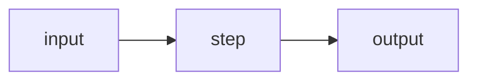

# Walkthrough: <milestone ID and name>

> A guided tour of the code this milestone added. Read it with the code open beside it.
> **Code at:** <commit SHA or tag> · **Spec:** [`docs/spec/milestones/<file>.md`](../../spec/milestones/<file>.md)

## 1. The 30-second version
<What happens when a user runs the command, in 5 bullet points.>

## 2. Data flow

## 3. Reading order
| # | File | Start at | What to notice |
|---|---|---|---|
| 1 | `src/cartographer/…` | `function()` | … |

## 4. End-to-end trace on a tiny fixture
<Take tests/fixtures/projects/<name>/. Show the input files, the intermediate objects at each stage (actual reprs), and the final output.>

## 5. The trickiest parts, explained
<The 2–4 places where the code is subtle, and why it is written that way.>

## 6. If you want to change…
| Change | Start at | Watch out for |
|---|---|---|
| Add a new … | | |

## 7. Tests to read
<Which tests best show the behaviour, in reading order.>
